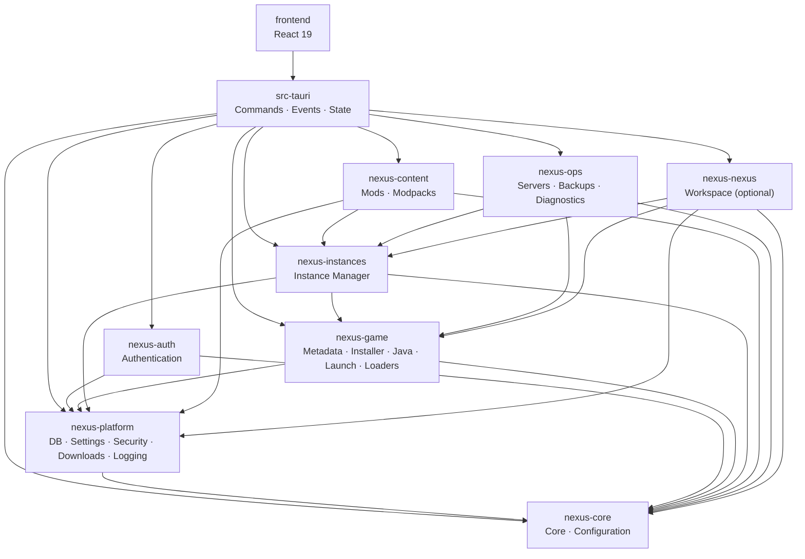
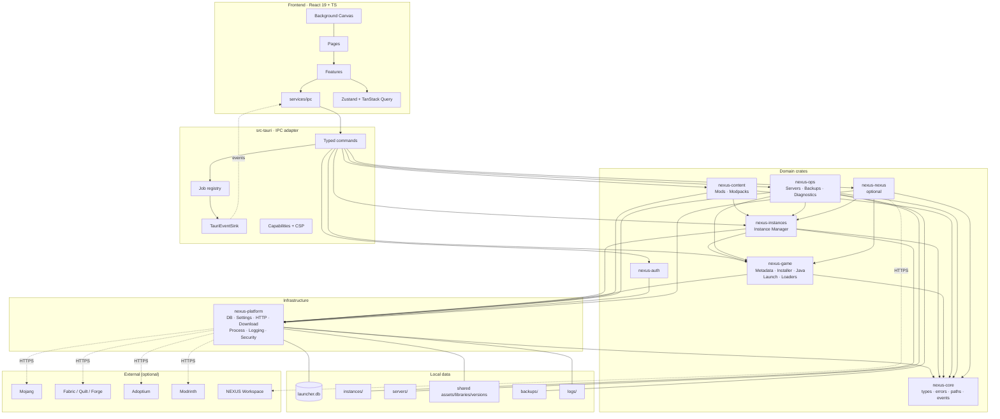

# Архитектура NEXUS-launcher

**Версия документа:** 1.0
**Дата:** 21.11.2026
**Статус:** архитектурный проект. Реализация не начата.
**Основание:** `docs/AUDIT.md`, `docs/ROADMAP.md`, `docs/STATUS.md`,
`MAIN-DEV-PLAN.md`, `NEXUS-server-docs/LAUNCHER_CONTRACT.md`,
`NEXUS-server-docs/MANIFEST.md`.
**Связанные документы:** `docs/DATABASE.md`, `docs/COMMANDS.md`,
`docs/EVENTS.md`, `docs/DECISIONS.md`.

---

## 0. Границы проекта

Документ описывает **архитектуру**, а не реализацию. Ни один игровой сценарий
здесь не реализован и не заявлен как работающий.

Что входит в архитектуру:

- границы модулей, их зависимости, публичные интерфейсы и ошибки;
- модель данных и миграции;
- IPC-контракт (команды и события);
- модель управления процессами;
- правила безопасности и расположения файлов;
- порядок реализации.

Что не входит:

- код, сборки, CI-конфигурация, UI-макеты;
- точные контракты внешних API, которые ещё не проверены (Forge/NeoForge
  installer, CurseForge, приватный Launcher API NEXUS);
- юридические решения (EULA, CurseForge Terms, подпись кода).

Внешние контракты, уже проверенные аудитом (Mojang, Fabric Meta, Quilt Meta,
Forge promotions, Modrinth, Adoptium, публичный NEXUS Launcher API),
используются как есть. Непроверенные контракты не выдумываются: для них
фиксируется «спайк до реализации» (см. `docs/DECISIONS.md`).

---

## 1. Обязательные правила

Эти правила действуют для всех модулей и проверяются на code review.

| № | Правило | Следствие |
|---|---|---|
| P1 | **Rust управляет всеми системными операциями** | Процессы, файлы, сеть, реестр, Job Objects, keyring — только в Rust |
| P2 | **Frontend не имеет прямого доступа к произвольной ФС** | Нет `fs`, `shell`, `http` plugins; нет команд `read_file(path)` / `write_file(path)` |
| P3 | **UI работает только через типизированные команды** | Каждая команда имеет request-DTO, response-DTO и стабильный код ошибки |
| P4 | **Общие данные передаются через события** | Прогресс, консоль, смена состояния — события; команды — только намерение пользователя |
| P5 | **NEXUS Workspace — необязательный компонент** | Нет источника → нет сетевых вызовов; все локальные функции работают |
| P6 | **Домен не зависит от Tauri** | Крейты `nexus-*` не импортируют `tauri`; UI-адаптер — только `src-tauri` |
| P7 | **Один SQLite-слой и один HTTP-стек** | SQLx (без `rusqlite`), `reqwest 0.13` через фасад `platform::net` |
| P8 | **Никаких секретов в БД, конфиге и логах** | Только `secret_ref` в keyring/DPAPI; redaction обязателен |

### 1.1. Что запрещено архитектурно

- выполнение shell-команд и склейка аргументов в строку;
- передача абсолютного пути из UI в файловую команду (кроме путей, выбранных
  пользователем в системном диалоге, и только на чтение архивов);
- возврат в UI сырых текстов ошибок SQL/HTTP и стектрейсов;
- автоматическое исполнение файлов из импортируемого архива;
- автоматическое обновление инстанса при выходе новой версии сборки;
- встраивание CurseForge API key в бинарник;
- фоновые сетевые запросы к NEXUS без настроенного источника.

### 1.2. Границы абстракций

Абстракции вводятся только там, где есть второй реальный вариант или тестовая
подмена. Сознательно **не** вводятся:

- универсальный ORM/репозиторий-бог;
- DI-контейнер;
- динамическая plugin-система;
- event sourcing и воспроизведение состояния из событий;
- универсальный `Provider` для всего;
- отдельный слой «сервисов» над каждым геттером.

Разрешённые и обоснованные trait-ы:

| Trait | Почему существует |
|---|---|
| `EventSink` | Tauri-адаптер + тестовая реализация без Tauri |
| `SecretStore` | Windows keyring + in-memory для тестов |
| `ProcessBackend` | Windows Job Objects + fake для тестов |
| `AuthProvider` | Offline и Microsoft уже в v1 |
| `LoaderAdapter` | Vanilla, Fabric, Quilt, Forge, NeoForge |
| `ContentProvider` | Modrinth в v1; второй источник запланирован, но не реализуется «на всякий случай» |

Все реализации компилируются в бинарник: динамической загрузки плагинов нет.

---

## 2. Контекст системы

```
Пользователь
   │
   ▼
NEXUS-launcher (desktop, Windows 11 x64)
   ├── React 19 UI ── typed IPC ── Rust core
   ├── локальные данные: SQLite, instances, servers, assets, backups
   └── внешние источники (по требованию):
         Mojang metadata, Fabric/Quilt/Forge, Adoptium,
         Modrinth, NEXUS Workspace (опционально)
```

Акторы:

- **Пользователь** — управляет инстансами, аккаунтами, серверами.
- **Лаунчер** — единственный, кто пишет в игровые каталоги и запускает
  процессы.
- **Minecraft/сервер** — дочерние процессы; лаунчер не модифицирует их
  память и не внедряется в них.
- **NEXUS Workspace** — необязательный каталог сборок; отказ от него не
  влияет на локальные функции.

---

## 3. Технологический стек

Версии фиксируются lockfile-ами. Источник версий — `docs/AUDIT.md` §8.
Правило: `Cargo.toml` и `package.json` не содержат разных minor-линий Tauri.

| Слой | Технология | Версия/ограничение |
|---|---|---|
| Язык ядра | Rust stable, Edition 2024 | rustc 1.100 (MSRV набора ≤ 1.95) |
| Desktop | Tauri 2 + `tauri-build` | 2.12.x, одна линия |
| UI | React + React DOM | 19.3.x |
| Язык UI | TypeScript | **6.0.3**, не 7.x (несовместим с typescript-eslint) |
| Сборка UI | Vite + `@vitejs/plugin-react` | Vite 8.3.x |
| Асинхронность | Tokio | multi-thread, `process`, `fs`, `sync`, `time` |
| HTTP | reqwest | **0.13**, rustls, stream, system-proxy |
| JSON | serde + serde_json | camelCase на границе IPC |
| БД | SQLite через SQLx | 0.9, `sqlite-bundled`, `migrate`; **без rusqlite** |
| Конфиг | TOML | bootstrap-настройки |
| Логи | tracing + tracing-subscriber | файлы + redaction |
| Архивы | zip | 9.x, `default-features = false` |
| Секреты | keyring (Windows Credential Manager) | `secret_ref` в БД |
| Процессы | `tokio::process` + Win32 Job Objects | без shell |
| Тесты | cargo test, Vitest, Playwright | офлайн по умолчанию |

Зависимости, которые **не добавляются**: `rusqlite` (конфликт `links`),
`axios`, Electron, Tauri `fs`/`shell`/`http` plugins, второй HTTP-клиент.

---

## 4. Cargo workspace и границы крейтов

### 4.1. Состав

```
crates/
  nexus-core          # Core, Application Configuration
  nexus-platform      # Database, Settings, Security, Download Manager, Logging
  nexus-auth          # Authentication
  nexus-game          # Minecraft Metadata, Installer, Java, Launch, Loaders
  nexus-instances     # Instance Manager
  nexus-content       # Mod Manager, Modpack Manager
  nexus-ops           # Server Manager, Backup Manager, Diagnostics
  nexus-nexus         # NEXUS Workspace Integration
src-tauri/            # IPC: команды, события, state, capabilities
frontend/             # React
migrations/           # SQLx migrations (общие для workspace)
```

Восемь библиотечных крейтов вместо пятнадцати из раннего черновика roadmap.
Причина: каждый крейт имеет минимум два модуля и самостоятельную тестовую
поверхность; дальнейшее дробление создаёт циклические зависимости и
преждевременные абстракции. Решение — ADR-001.

### 4.2. Направление зависимостей



Стрелка `A --> B` означает «A зависит от B». Циклы запрещены и проверяются
`cargo metadata`/`cargo deny` в CI.

Ключевые ограничения:

- `nexus-game` **не знает** про инстансы: установка и запуск принимают
  `InstallTarget` и `LaunchRequest` (пути + параметры), а не `InstanceManifest`.
- `nexus-instances` владеет каталогами инстансов и строит `LaunchRequest`.
- `nexus-content` и `nexus-nexus` не пишут файлы напрямую, а используют
  `InstanceService` и `DownloadManager`.
- `nexus-ops` не вызывается из `nexus-instances`; обратное направление
  (backup → instance) допустимо и не создаёт цикла.
- `src-tauri` — композиционный корень: создаёт сервисы, запускает job-ы,
  преобразует ошибки в `ErrorDto`, публикует события.
- Ни один доменный крейт не зависит от `reqwest` напрямую; HTTP — только
  через `nexus_platform::net::HttpClient`.

### 4.3. Зависимости по крейтам

| Крейт | Внешние зависимости (основные) | Внутренние |
|---|---|---|
| `nexus-core` | serde, serde_json, thiserror, uuid, time, toml, unicode-normalization, dunce, secrecy, zeroize, tokio-util (CancellationToken) | — |
| `nexus-platform` | sqlx, reqwest, tokio, tokio-util, futures, sha1, sha2, zip, keyring, zeroize, secrecy, url, tracing, tracing-subscriber, tracing-appender, sysinfo, windows, walkdir, tempfile | core |
| `nexus-auth` | sqlx, serde, async-trait, uuid (v3), secrecy, zeroize, sha1 | core, platform |
| `nexus-game` | serde, serde_json, zip, async-trait, quick-xml (только если подтверждён парсинг Maven), semver | core, platform |
| `nexus-instances` | sqlx, serde, serde_json, uuid, tokio, walkdir, zip | core, platform, game |
| `nexus-content` | sqlx, serde, serde_json, url, sha1, zip | core, platform, game, instances |
| `nexus-ops` | sqlx, serde, serde_json, zip, sysinfo, windows, walkdir, tokio | core, platform, game, instances |
| `nexus-nexus` | sqlx, serde, serde_json, url, sha2 | core, platform, game, instances |
| `src-tauri` | tauri, tauri-plugin-single-instance, tauri-plugin-dialog, tauri-plugin-opener, tokio, tracing | все крейты |

---

## 5. Слои и поток вызова

```
┌─────────────────────────────────────────────────────────────┐
│ React UI                                                     │
│  pages → features → services/ipc → invoke/event              │
└───────────────────────────┬─────────────────────────────────┘
                            │ typed IPC (camelCase DTO)
┌───────────────────────────▼─────────────────────────────────┐
│ src-tauri (адаптер)                                          │
│  commands/  validation  job registry  event adapter  state   │
└───────────────────────────┬─────────────────────────────────┘
                            │ Rust API (snake_case, domain types)
┌───────────────────────────▼─────────────────────────────────┐
│ Доменные сервисы (nexus-*)                                   │
│  правила, планы, транзакции, проверки                        │
└───────────────────────────┬─────────────────────────────────┘
                            │
┌───────────────────────────▼─────────────────────────────────┐
│ Инфраструктура (nexus-platform)                               │
│  SQLite · HTTP · filesystem · downloads · secrets · logs      │
│  process (Job Objects, pipes)                                 │
└───────────────────────────┬─────────────────────────────────┘
                            │
                     OS / внешние сервисы
```

Правило преобразования:

1. Команда валидирует **форму** входа (длины, диапазоны, enum, отсутствие
   управляющих символов) и передаёт доменный тип.
2. Доменный сервис проверяет **смысл** (существует ли инстанс, совместим ли
   мод, не занят ли файл).
3. Ошибки домена преобразуются в `NexusError` → `ErrorDto` один раз, в
   адаптере.
4. Долгая операция создаёт `Job`, возвращает `jobId` и публикует прогресс
   событиями.
5. UI после события перезапрашивает авторитетное состояние командой; события
   не являются единственным источником истины.

---

## 6. Структура папок

### 6.1. Репозиторий

```
NEXUS-Launcher/
├── Cargo.toml                  # [workspace]
├── Cargo.lock
├── rust-toolchain.toml
├── rustfmt.toml
├── clippy.toml
├── .editorconfig
├── .gitignore                  # target/, node_modules/, dist/, *.db, logs/
├── README.md
├── MAIN-DEV-PLAN.md
├── crates/
│   ├── nexus-core/
│   │   ├── Cargo.toml
│   │   └── src/
│   │       ├── lib.rs
│   │       ├── error.rs           # NexusError, ErrorCode
│   │       ├── ids.rs
│   │       ├── time.rs            # Clock
│   │       ├── paths.rs           # DataPaths, RootedDir, SafeRelPath
│   │       ├── fs_safety.rs
│   │       ├── events.rs          # EventSink, DomainEvent, AppEvent
│   │       ├── jobs.rs            # JobCtx, ProgressSink
│   │       └── config.rs          # LauncherConfig, bootstrap TOML
│   ├── nexus-platform/
│   │   └── src/
│   │       ├── lib.rs
│   │       ├── db/                # pool, migrations, helpers
│   │       ├── settings/          # SettingsService, app_settings
│   │       ├── net/               # HttpClient, retry, policy, UA
│   │       ├── download/          # queue, files, resume, staging
│   │       ├── security/          # secrets, archive guard, redaction
│   │       ├── logging/           # tracing init, file writers
│   │       └── process/           # ProcessBackend, Job Objects
│   ├── nexus-auth/
│   ├── nexus-game/
│   │   └── src/
│   │       ├── metadata/
│   │       ├── install/
│   │       ├── java/
│   │       ├── launch/
│   │       └── loaders/
│   ├── nexus-instances/
│   ├── nexus-content/
│   │   └── src/{mods,modpacks}/
│   ├── nexus-ops/
│   │   └── src/{servers,backups,diagnostics}/
│   └── nexus-nexus/
├── src-tauri/
│   ├── Cargo.toml
│   ├── build.rs
│   ├── tauri.conf.json
│   ├── capabilities/
│   │   └── main.json
│   ├── icons/
│   ├── permissions/
│   └── src/
│       ├── main.rs
│       ├── lib.rs                 # run(), composition root
│       ├── state.rs               # AppState, Services
│       ├── bootstrap.rs           # порядок старта
│       ├── jobs.rs                # JobRegistry, cancel, progress throttle
│       ├── events.rs              # TauriEventSink
│       ├── commands/
│       │   ├── mod.rs
│       │   ├── app.rs
│       │   ├── settings.rs
│       │   ├── jobs.rs
│       │   ├── instances.rs
│       │   ├── minecraft.rs
│       │   ├── loaders.rs
│       │   ├── java.rs
│       │   ├── launch.rs
│       │   ├── accounts.rs
│       │   ├── mods.rs
│       │   ├── modpacks.rs
│       │   ├── downloads.rs
│       │   ├── servers.rs
│       │   ├── nexus.rs
│       │   ├── backups.rs
│       │   └── diagnostics.rs
│       └── dto/                   # IPC-only типы
├── frontend/
│   ├── package.json
│   ├── package-lock.json
│   ├── vite.config.ts
│   ├── tsconfig.json
│   ├── index.html
│   ├── eslint.config.js
│   └── src/
│       ├── main.tsx
│       ├── app/                   # providers, bootstrap, events, routing
│       ├── components/            # общие компоненты
│       ├── layouts/
│       ├── pages/                 # 10 разделов
│       ├── features/              # доменные слайсы
│       ├── services/ipc/          # типизированные обёртки invoke
│       ├── stores/                # zustand: только UI-состояние
│       ├── hooks/
│       ├── types/                 # DTO-зеркала + event payloads
│       ├── styles/
│       └── background/            # один Canvas-слой на приложение
├── migrations/
│   ├── 0001_init.sql
│   └── ...
├── resources/                     # статические ресурсы приложения
├── tests/                         # межкрейтовые интеграционные тесты
├── docs/
│   ├── reference/                 # копии контрактов NEXUS + версия
│   └── schemas/                   # JSON Schema instance/server/backup
└── scripts/                       # проверки, генерация фикстур
```

### 6.2. Каталог данных (per-user)

Фиксируется ADR-003: только `%LOCALAPPDATA%`, не Roaming.

```
%LOCALAPPDATA%\NEXUS-Launcher\
├── config.toml                    # bootstrap-конфиг
├── launcher.db                    # SQLite + WAL/SHM
├── logs\
│   ├── launcher\2026-11-21.log
│   ├── game\<instance_id>\<run_id>.log
│   └── server\<server_id>\<date>.log
├── cache\
│   ├── meta\                      # version manifest, version JSON, ETag
│   └── downloads\                 # временные ответы/эталоны (по необходимости)
├── shared\
│   ├── assets\                    # objects/, indexes/
│   ├── libraries\
│   └── versions\<version_id>\     # version.json, client.jar, natives/
├── instances\<instance_id>\
│   ├── instance.json
│   ├── instance.lock.json
│   ├── icon.png
│   ├── .nexus\                    # staging, backup-перед-изменением
│   └── game\                      # игровая директория Minecraft
│       ├── mods\
│       ├── config\
│       ├── saves\
│       ├── resourcepacks\
│       ├── shaderpacks\
│       ├── logs\
│       └── crash-reports\
├── servers\<server_id>\
│   ├── server.json
│   ├── server.lock.json
│   ├── .nexus\run.json            # идентичность живого процесса
│   └── server\                    # cwd сервера: world/, mods/, plugins/
├── java\<vendor>-<major>-<arch>\
├── downloads\staging\<job_id>\
├── backups\<target_kind>\<target_id>\
└── runs\                          # индекс запусков клиента
```

Правила:

- Имя каталога инстанса/сервера — **стабильный UUID**, а не пользовательское
  имя. Переименование не перемещает файлы.
- `game/` — одновременно игровая директория и место модов/конфигов. Это
  устраняет двусмысленность ТЗ (в примере `mods/` и `game/` находились на
  одном уровне, что несовместимо с `game_directory`). Решение — ADR-006.
- Общие `assets/`, `libraries/`, `versions/`, `java/` — только кэш; удаление
  инстанса их не затрагивает.
- Всё, что создаёт инстанс, создаётся внутри `instances/<id>`; общий кэш
  наполняется только установщиком.

---

## 7. Модули

Формат каждого модуля: ответственность → структуры → публичный интерфейс →
зависимости → ошибки → события → тесты.

### 7.1. Core

**Ответственность.** Базовые типы и правила, на которых стоят все остальные
модули: идентификаторы, время, ошибки, пути и fs-safety, контракт событий,
контекст job-а, загрузка bootstrap-конфига. Core не знает про Tauri, HTTP,
SQLite и Minecraft.

**Внутренние структуры.**

| Тип | Назначение |
|---|---|
| `InstanceId`, `ServerId`, `AccountId`, `SourceId`, `JobId`, `RunId` | Newtype над `Uuid`; нельзя перепутать аргументы |
| `Clock` / `SystemClock` / `FixedClock` | Инъекция времени; тесты без `sleep` |
| `DataPaths` | Корни всех каталогов данных; вычисляются один раз |
| `SafeRelPath` | Проверенный относительный путь с `/`, NFC, без `..`, ADS, reserved names |
| `RootedDir` | Каталог-корень + `resolve(SafeRelPath)` с проверкой выхода |
| `NexusError`, `ErrorCode` | Единая ошибка и стабильные коды |
| `DomainEvent`, `EventSink`, `AppEvent` | Контракт публикации событий без зависимости от Tauri |
| `JobCtx`, `ProgressSink` | Отмена, прогресс, идентификатор операции |
| `LaunchSession` | Креденшелы запуска (username, uuid, token) без зависимости game → auth |
| `LauncherConfig` | Bootstrap-настройки из `config.toml` |

**Публичный интерфейс (эскиз).**

```rust
pub trait Clock: Send + Sync { fn now_ms(&self) -> i64; }

pub struct DomainEvent {
    pub name: &'static str,
    pub event_id: Uuid,
    pub occurred_at_ms: i64,
    pub job_id: Option<JobId>,
    pub entity: Option<EntityRef>,
    pub payload: serde_json::Value,
}

pub trait AppEvent: serde::Serialize {
    const NAME: &'static str;
    fn job_id(&self) -> Option<JobId> { None }
    fn entity(&self) -> Option<EntityRef> { None }
}

pub trait EventSink: Send + Sync {
    fn emit(&self, event: DomainEvent);
}

pub fn emit<E: AppEvent>(sink: &dyn EventSink, clock: &dyn Clock, event: &E);

pub struct JobCtx { /* id, CancellationToken, ProgressSink */ }
impl JobCtx {
    pub fn id(&self) -> JobId;
    pub fn check_cancelled(&self) -> Result<(), NexusError>;
    pub fn progress(&self, stage: &str, done: u64, total: Option<u64>);
}

pub struct LaunchSession {
    pub username: String,
    pub uuid: Uuid,
    pub access_token: SecretString,   // Debug/Display редактируются
    pub user_type: UserType,          // msa | legacy | offline
}

impl DataPaths {
    pub fn resolve_default() -> Result<Self, CoreError>;
    pub fn with_root(root: PathBuf) -> Result<Self, CoreError>;
    pub fn instance_dir(&self, id: InstanceId) -> RootedDir;
    pub fn server_dir(&self, id: ServerId) -> RootedDir;
}

impl RootedDir {
    pub fn resolve(&self, rel: &SafeRelPath) -> Result<PathBuf, CoreError>;
    pub async fn atomic_write(&self, rel: &SafeRelPath, bytes: &[u8]) -> Result<(), CoreError>;
    pub fn staging(&self, name: &str) -> Result<PathBuf, CoreError>;
}

pub fn load_config(path: &Path) -> Result<LoadedConfig, CoreError>;
```

**Зависимости.** Только стандартная библиотека и базовые крейты; ни одного
доменного крейта.

**Ошибки.** `CoreError::{InvalidPath, PathEscape, ReservedName, CaseCollision,
ConfigParse, ConfigWrite, Io, Internal}`. Коды: `INVALID_PATH`,
`PATH_OUTSIDE_ROOT`, `RESERVED_NAME`, `PATH_COLLISION`, `CONFIG_INVALID`,
`CONFIG_WRITE_FAILED`.

**События.** Core определяет контракт (`DomainEvent`, `EventSink`,
`AppEvent`); сам событий не публикует. `app:error` формирует адаптер.

**Тесты.**

- `SafeRelPath`: `..`, абсолютные пути, `C:`, UNC, ADS, `CON`, `COM1`,
  хвостовые точка/пробел, NFD→NFC, регистронезависимые коллизии.
- `RootedDir`: junction/symlink-побег, путь внутри корня, длинный путь.
- `atomic_write`: существующий файл, сбой записи, восстановление `.bak`.
- `LauncherConfig`: round-trip, неизвестные поля, отсутствующий файл,
  невалидный TOML, миграция `schema_version`.
- `ErrorCode`: сериализация, стабильность кодов, отсутствие сырых путей в
  `Display`.
- `FixedClock`: детерминизм событий.

---

### 7.2. Application Configuration

**Ответственность.** Двухуровневая конфигурация:

1. `config.toml` — только то, что нужно **до** открытия БД: каталог данных,
   сеть, лимиты загрузок, логирование, флаги безопасности.
2. `app_settings` (SQLite) — пользовательские настройки, доступные из UI:
   тема, reduced motion, язык, поведение при закрытии, параметры по
   умолчанию для новых инстансов.
3. Секреты — никогда не в конфиге и не в БД, только `secret_ref`.

**Внутренние структуры.**

- `BootstrapConfig` (TOML, `schema_version = 1`).
- `SettingsPatch` — типизированный patch с `Option`-полями по группам.
- `EffectiveSettings` — слияние defaults → `config.toml` → `app_settings`.
- `SettingsService` — чтение/запись `app_settings`, валидация, событие.

**Публичный интерфейс.**

```rust
pub struct SettingsService { /* db, events */ }
impl SettingsService {
    pub async fn get(&self) -> Result<EffectiveSettings, SettingsError>;
    pub async fn apply(&self, patch: SettingsPatch) -> Result<EffectiveSettings, SettingsError>;
    pub async fn reset_group(&self, group: SettingsGroup) -> Result<EffectiveSettings, SettingsError>;
}
```

Ключи `app_settings` типизированы; произвольный JSON-ключ из UI не
принимается. Неизвестные ключи в БД сохраняются, но не влияют на поведение
(совместимость вперёд).

**Зависимости.** Core; в части БД — Platform.

**Ошибки.** `SettingsError::{InvalidValue, UnknownKey, ReadOnlyKey,
DbUnavailable, WriteFailed}`; коды `SETTINGS_INVALID`,
`SETTINGS_READ_ONLY`, `SETTINGS_WRITE_FAILED`.

**События.** `app:settings-changed` с `changedKeys[]`. Bootstrap-изменения,
требующие перезапуска, помечаются `requiresRestart: true`.

**Тесты.** Приоритет источников; валидация диапазонов (RAM, потоки,
таймауты); запрет секретов; частичное обновление; сохранение неизвестных
ключей; атомарная запись TOML; поведение при повреждённом файле (резервная
копия + значения по умолчанию).

---

### 7.3. Database

**Ответственность.** Одно соединение с SQLite на процесс, пул, PRAGMA,
миграции, проверка целостности, резервная копия перед миграцией, транзакции.
Репозитории доменов живут в своих крейтах и получают `&SqlitePool` (поэтому
доменные крейты зависят от `sqlx`, но не от `rusqlite`); Database не
превращается в «бог-репозиторий».

**Внутренние структуры.**

- `Db { pool: SqlitePool, path: PathBuf }`.
- `DbOptions { max_connections = 8, busy_timeout_ms = 5000 }`.
- `MigrationReport { from, to, applied: Vec<String>, backup_path }`.
- `DbHealth { ok, journal_mode, foreign_keys, schema_version, integrity }`.

**Публичный интерфейс.**

```rust
impl Db {
    pub async fn open(path: &Path, opts: DbOptions) -> Result<Self, DbError>;
    pub async fn migrate(&self, events: &dyn EventSink) -> Result<MigrationReport, DbError>;
    pub fn pool(&self) -> &SqlitePool;
    pub async fn health(&self) -> Result<DbHealth, DbError>;
    pub async fn begin(&self) -> Result<Transaction<'_, Sqlite>, DbError>;
    pub async fn backup_to(&self, path: &Path) -> Result<(), DbError>;
}
```

**Зависимости.** Core.

**Ошибки.** `DbError::{Open, Busy, Migration, SchemaTooNew, Integrity, Backup,
Query, Pool}`; коды `DB_UNAVAILABLE`, `DB_BUSY`, `DB_MIGRATION_FAILED`,
`DB_SCHEMA_TOO_NEW`, `DB_INTEGRITY`, `DB_BACKUP_FAILED`.

**События.** `db:ready`, `db:migration-progress`, `db:degraded`.

**Тесты.** Чистая миграция; апгрейд с фикстуры предыдущей версии; отказ при
`schema_version` новее; WAL и `foreign_keys`; параллельная запись;
`busy_timeout`; каскады; `integrity_check`; бэкап перед миграцией.

---

### 7.4. Security

**Ответственность.** Секреты, zip-архивы, сетевые политики, redaction.
Fs-safety вынесен в Core, потому что им пользуются все домены.

**Внутренние структуры.**

| Тип | Назначение |
|---|---|
| `SecretStore` (trait) | `put/get/delete` по `SecretKey`; Windows Credential Manager |
| `MemorySecretStore` | Только для тестов |
| `UrlPolicy` | Схемы, loopback/private, redirects, userinfo, порт, размер |
| `ArchiveLimits` | Записи, байты, отношение сжатия, глубина, длина пути |
| `SafeArchive` / `SafeEntry` | Проверенное чтение zip без исполнения |
| `Redactor` | Маскирование по ключам и по известным значениям |

**Публичный интерфейс.**

```rust
pub trait SecretStore: Send + Sync {
    fn put(&self, key: &SecretKey, value: &SecretString) -> Result<(), SecretError>;
    fn get(&self, key: &SecretKey) -> Result<Option<SecretString>, SecretError>;
    fn delete(&self, key: &SecretKey) -> Result<(), SecretError>;
}

pub struct UrlPolicy { /* allow_local_sources: bool */ }
impl UrlPolicy {
    pub fn check(&self, url: &Url, purpose: UrlPurpose) -> Result<(), SecurityError>;
}

impl SafeArchive {
    pub fn open(path: &Path, limits: ArchiveLimits) -> Result<Self, SecurityError>;
    pub fn extract(&mut self, target: &RootedDir, opts: &ExtractOptions)
        -> Result<ExtractReport, SecurityError>;
}

pub fn install_redaction_layer(); // tracing layer
```

`UrlPurpose`: `MojangMetadata`, `Modrinth`, `Adoptium`, `NexusSource`,
`ArtifactDownload`, `UserServer`. Локальные адреса разрешены только для
`NexusSource` при явно включённом флаге (self-hosted).

**Зависимости.** Core.

**Ошибки.** `SecurityError::{UnsafePath, ArchiveEntry, ArchiveLimit,
ArchiveRatio, SymlinkRejected, UrlRejected, TlsRequired, SecretUnavailable,
SecretAccess}`; коды `UNSAFE_PATH`, `ARCHIVE_UNSAFE`, `ARCHIVE_LIMIT`,
`URL_REJECTED`, `TLS_REQUIRED`, `SECRET_STORE_UNAVAILABLE`.

**События.** `security:degraded` (keyring недоступен, TLS-политика ослаблена
явной настройкой). События с секретами запрещены.

**Тесты.** Zip Slip, zip bomb по размеру/отношению/числу записей, symlink в
zip, дубликаты путей без учёта регистра, SSRF (loopback, link-local, private,
`file://`, userinfo), редирект HTTPS→HTTP, отсутствие секретов в `Display` и
логах, keyring round-trip (условный), redaction по ключам и значениям.

---

### 7.5. Authentication

**Ответственность.** Провайдеры аккаунтов, сессии, обновление токенов,
offline-профили, безопасное хранение. Не знает про инстансы и запуск.

**Внутренние структуры.**

- `AuthProvider` (trait), `OfflineProvider`, `MicrosoftProvider`.
- `LoginChallenge` — device code (`user_code`, `verification_uri`,
  `expires_at`) либо будущий redirect-flow.
- `AccountSession` — `account_id`, `username`, `uuid`, `access_token`,
  `refresh_token`, `expires_at`, `entitlements`.
- `SecretString` (`secrecy` + `zeroize`) для токенов.
- `AccountRepository` поверх SQLite; в БД только `secret_ref`.

**Публичный интерфейс.**

```rust
#[async_trait]
pub trait AuthProvider: Send + Sync {
    fn kind(&self) -> ProviderKind;
    async fn begin_login(&self) -> Result<LoginChallenge, AuthError>;
    async fn poll_login(&self, challenge: &LoginChallenge)
        -> Result<LoginPoll, AuthError>; // Pending | SlowDown | Done(session)
    async fn refresh(&self, account: &Account) -> Result<AccountSession, AuthError>;
    async fn logout(&self, account: &Account) -> Result<(), AuthError>;
}

impl AuthService {
    pub async fn list(&self) -> Result<Vec<Account>, AuthError>;
    pub async fn active(&self) -> Result<Option<Account>, AuthError>;
    pub async fn set_active(&self, id: AccountId) -> Result<Account, AuthError>;
    pub async fn begin_login(&self, kind: ProviderKind) -> Result<LoginChallenge, AuthError>;
    pub async fn cancel_login(&self, challenge_id: Uuid) -> Result<(), AuthError>;
    pub async fn create_offline(&self, name: &str) -> Result<Account, AuthError>;
    pub async fn remove(&self, id: AccountId) -> Result<(), AuthError>;
    pub async fn session_for_launch(&self, id: AccountId) -> Result<LaunchSession, AuthError>;
}
```

Microsoft-цепочка фиксируется по официальной документации: OAuth device code →
Xbox Live → XSTS → Minecraft Services → профиль/entitlements. Точные URL и
scopes берутся из актуальной документации в момент реализации, а не
изобретаются здесь.

Offline UUID: `uuid v3` от `OfflinePlayer:<name>`; в UI всегда помечается как
офлайн-профиль.

**Зависимости.** Core, Platform (net, secrets, db через репозиторий).

**Ошибки.** `AuthError::{ProviderUnavailable, InvalidResponse, UserCancelled,
Expired, RefreshFailed, EntitlementMissing, XboxDenied, SecretStore,
RateLimited}`; коды `AUTH_UNAVAILABLE`, `AUTH_FAILED`, `AUTH_EXPIRED`,
`AUTH_NO_ENTITLEMENT`, `AUTH_CANCELLED`, `AUTH_SECRET_STORE`.

**События.** `auth:device-code`, `auth:login-completed`, `auth:login-failed`,
`auth:account-updated`, `auth:account-removed`.

**Тесты.** Offline UUID (детерминизм, version/variant, регистр), парсинг
ответов (фикстуры), refresh с mock HTTP, истечение и отмена, удаление
аккаунта удаляет секрет, отсутствие токенов в логах/ошибках, недоступный
keyring (fail-closed, без plaintext-fallback), уникальность
`(provider, provider_account_id)`.

---

### 7.6. Minecraft Metadata

**Ответственность.** Каталог версий Mojang, version JSON с наследованием,
правила выбора библиотек/natives по ОС и аргументам, asset index, требование
Java. Никакой установки и записи игровых файлов.

**Внутренние структуры.**

- `VersionCatalog { latest: LatestVersions, versions: Vec<VersionSummary> }`.
- `VersionJson` с `#[serde(flatten)] extra` (сохранение неизвестных полей).
- `Library { name, downloads, natives, rules, extract }`.
- `Rule { action, os, features }`, `Argument` (строка или объект).
- `AssetIndex`, `JavaVersion`.
- `MetadataCache` — файлы в `cache/meta`, ETag/Last-Modified, TTL каталога
  60 минут.
- `ResolvedVersion` — плоская версия после `inheritsFrom`.

**Публичный интерфейс.**

```rust
impl MetadataService {
    pub async fn catalog(&self, refresh: RefreshPolicy)
        -> Result<VersionCatalog, MetadataError>;
    pub async fn version(&self, id: &str) -> Result<ResolvedVersion, MetadataError>;
    pub fn libraries_for(&self, v: &ResolvedVersion, platform: &Platform)
        -> Result<Vec<ResolvedLibrary>, MetadataError>;
    pub fn asset_index_for(&self, v: &ResolvedVersion) -> Result<AssetIndexRef, MetadataError>;
    pub fn java_requirement(&self, v: &ResolvedVersion) -> JavaRequirement;
}
```

**Зависимости.** Core, Platform (net).

**Ошибки.** `MetadataError::{Network, HttpStatus, InvalidJson, UnknownVersion,
InheritanceCycle, CacheUnavailable, UnsupportedFormat}`; коды
`METADATA_UNAVAILABLE`, `METADATA_INVALID`, `VERSION_NOT_FOUND`,
`VERSION_INHERITANCE_CYCLE`.

**События.** `minecraft:catalog-updated`, `minecraft:metadata-updated`
(включая `stale: true` при работе из кэша).

**Тесты.** Фикстуры `26.2` (modern natives как библиотеки), `1.16.5`
(classifiers/natives), `1.12.2` (legacy assets), правила ОС/arch/features,
наследование и цикл, неизвестные поля, ETag/304, офлайн-fallback, отсутствие
жёсткой таблицы «версия → Java».

---

### 7.7. Minecraft Installer

**Ответственность.** Декларативный план установки версии и его идемпотентное
исполнение: client jar, библиотеки, assets, natives, logging config. Общий
кэш `shared/` и версии в `shared/versions/`.

**Внутренние структуры.**

- `InstallRequest { version, target: InstallTarget, java_major }`.
- `InstallTarget { versions, libraries, assets, natives }` (`RootedDir`).
- `InstallPlan { files: Vec<PlannedFile>, total_bytes }`.
- `PlannedFile { kind, url, rel_path, size, hashes, required }`.
- `InstallReceipt { installed, skipped, bytes_downloaded }`.
- `InstalledVersion` + `.nexus-install.json` (хэши, дата, версия лаунчера).
- Блокировка `shared/versions/.locks/<version_id>.lock`.

**Публичный интерфейс.**

```rust
impl Installer {
    pub async fn plan(&self, req: &InstallRequest) -> Result<InstallPlan, InstallError>;
    pub async fn execute(&self, plan: InstallPlan, job: &JobCtx)
        -> Result<InstallReceipt, InstallError>;
    pub async fn verify(&self, version: &InstalledVersion, job: &JobCtx)
        -> Result<VerifyReport, InstallError>;
    pub async fn repair(&self, req: &InstallRequest, job: &JobCtx)
        -> Result<InstallReceipt, InstallError>;
}
```

Правила:

- Проверка существующего файла — по размеру и SHA-1 (официальные хэши Mojang),
  SHA-256 — где он доступен. Несовпадение → повторная загрузка один раз.
- Скачивание только через `DownloadManager` (Range, retry, staging).
- Natives распаковываются `SafeArchive` с учётом `extract.exclude`.
- Атомарная замена: staging → rename; антивирусный retry с backoff.
- План не содержит абсолютных путей; всё через `RootedDir`.
- Параллельная установка одной версии запрещена блокировкой.

**Зависимости.** Core, Platform (download/net/security), Game/Metadata.

**Ошибки.** `InstallError::{PlanInvalid, IntegrityMismatch, DownloadFailed,
DiskFull, Locked, NativesExtract, CacheCorrupt}`; коды `INSTALL_INVALID`,
`INTEGRITY_MISMATCH`, `DISK_SPACE`, `INSTALL_LOCKED`, `NATIVES_EXTRACT`.

**События.** `minecraft:install-started`, `minecraft:install-progress`,
`minecraft:install-completed`, `minecraft:install-failed`,
`minecraft:verify-failed`.

**Тесты.** Фикстуры планов, повторная установка без скачивания, hash/size
mismatch, обрыв и resume, natives exclude, запрет выхода за каталог, две
параллельные установки, нехватка места, повреждённый кэш.

---

### 7.8. Instance Manager

**Ответственность.** Владелец каталогов инстансов и их манифестов: CRUD,
клонирование, архивирование, удаление, импорт/экспорт, иконки, проверка
целостности, сборка `LaunchRequest`. Не содержит логики установки Minecraft и
не пишет в общий кэш.

**Внутренние структуры.**

- `InstanceManifest` (schema v1), `InstanceLock` (schema v1) — см. §8.1–8.2.
- `Instance { manifest, paths, summary }`.
- `InstancePatch` — типизированное изменение.
- `InstanceLocks` — `tokio::sync::Mutex` на `InstanceId`.
- `InstanceRepository` — индекс в SQLite (источник истины — манифест).
- `ValidationReport { missing, modified, unexpected, lock_mismatch }`.

**Публичный интерфейс.**

```rust
impl InstanceService {
    pub async fn list(&self, filter: ListFilter) -> Result<Vec<InstanceSummary>, InstanceError>;
    pub async fn get(&self, id: InstanceId) -> Result<Instance, InstanceError>;
    pub async fn create(&self, req: CreateInstance) -> Result<Instance, InstanceError>;
    pub async fn update(&self, id: InstanceId, patch: InstancePatch)
        -> Result<Instance, InstanceError>;
    pub async fn clone(&self, id: InstanceId, req: CloneInstance, job: &JobCtx)
        -> Result<Instance, InstanceError>;
    pub async fn delete(&self, id: InstanceId, mode: DeleteMode)
        -> Result<DeleteReceipt, InstanceError>;
    pub async fn set_icon(&self, id: InstanceId, source: IconSource)
        -> Result<Instance, InstanceError>;
    pub async fn validate(&self, id: InstanceId, job: &JobCtx)
        -> Result<ValidationReport, InstanceError>;
    pub async fn build_launch_request(&self, id: InstanceId, session: LaunchSession)
        -> Result<LaunchRequest, InstanceError>;
    pub async fn acquire_exclusive(&self, id: InstanceId) -> InstanceGuard;
}
```

Правила:

- Создание: каталог по UUID, `game/`, `instance.json`, запись в БД — в одной
  операции; при сбое — очистка staging.
- Клонирование копирует `game/` целиком, новый `id`, независимый lock;
  общий кэш не копируется.
- Удаление: только по явному подтверждению (`DeleteMode::Permanent`), с
  предварительной проверкой, что инстанс не запущен. Каталог сначала
  переименовывается в `.nexus/trash/<id>`, затем удаляется.
- Переименование меняет только `name` в манифесте и БД.
- Иконка: копируется в `icon.png`, проверка размера/формата; UI получает её
  через узкий asset-scope.
- `instance.lock.json` обновляется только установщиком/мод-менеджером.

**Зависимости.** Core, Platform (db), Game (install/launch типы).

**Ошибки.** `InstanceError::{NotFound, Conflict, ManifestInvalid,
ManifestTooNew, DirNotEmpty, Running, Locked, PathEscape, Io, ImportFailed}`;
коды `INSTANCE_NOT_FOUND`, `INSTANCE_EXISTS`, `INSTANCE_INVALID`,
`INSTANCE_SCHEMA_TOO_NEW`, `INSTANCE_RUNNING`, `INSTANCE_LOCKED`.

**События.** `instance:created`, `instance:updated`, `instance:deleted`,
`instance:install-progress`, `instance:installed`, `instance:validated`,
`instance:exported`, `instance:validation-failed`.

**Тесты.** Manifest round-trip с неизвестными полями; миграция v1; clone
создаёт независимую копию; удаление не трогает общий кэш; два инстанса с
разными модами не пересекаются; запрет операций при запущенном процессе;
переименование не перемещает каталог; битый манифест → понятная ошибка, а не
падение; case-insensitive коллизии.

---

### 7.9. Java Runtime Manager

**Ответственность.** Обнаружение, проверка и установка Java; выбор runtime
под требование версии Minecraft/загрузчика. Не запускает игру.

**Внутренние структуры.**

- `JavaRuntime { id, vendor, major, arch, path, source, verified_at }`.
- `JavaDetector` — PATH, реестр `JavaSoft`, стандартные каталоги, managed.
- `JavaProbe` — запуск `java -XshowSettings:properties -version` и разбор
  `java.version`, `os.arch`, vendor.
- `JavaInstaller` — Adoptium API v3, JRE, Windows x64, checksum + size.
- `JavaResolution::{Ready(runtime), Missing{major}, Incompatible{...}}`.

**Публичный интерфейс.**

```rust
impl JavaService {
    pub async fn list(&self) -> Result<Vec<JavaRuntime>, JavaError>;
    pub async fn detect(&self, job: &JobCtx) -> Result<Vec<JavaRuntime>, JavaError>;
    pub async fn register_external(&self, path: &Path) -> Result<JavaRuntime, JavaError>;
    pub async fn install(&self, req: JavaInstallRequest, job: &JobCtx)
        -> Result<JavaRuntime, JavaError>;
    pub async fn resolve(&self, req: JavaRequirement)
        -> Result<JavaResolution, JavaError>;
    pub async fn remove(&self, id: JavaRuntimeId) -> Result<RemovalReceipt, JavaError>;
}
```

Правила:

- Требование берётся из `javaVersion.majorVersion` конкретной версии; загрузчик
  может его повысить.
- Приоритет: точное совпадение major и arch; затем установленный managed;
  иначе `Missing` с предложением установки.
- Несовместимый major не подставляется молча; пользовательский
  `custom_path` не обходит предупреждение.
- Managed runtime удаляется только если на него нет ссылок из манифестов.

**Зависимости.** Core, Platform (net/download/process/db).

**Ошибки.** `JavaError::{NotFound, ProbeFailed, UnsupportedArch,
Incompatible, Download, Verify, Extract, InUse, WriteFailed}`; коды
`JAVA_NOT_FOUND`, `JAVA_INCOMPATIBLE`, `JAVA_ARCH_UNSUPPORTED`,
`JAVA_INSTALL_FAILED`, `JAVA_IN_USE`.

**События.** `java:runtimes-changed`, `java:install-progress`,
`java:install-completed`, `java:install-failed`.

**Тесты.** Разбор версий 8/17/21/25 и вендоров; `1.8.0_503` → 8; архитектура
x86 vs x64; выбор exact match; отказ при несовместимости; установка с mock
Adoptium (checksum mismatch); удаление используемого runtime запрещено;
недоступный PATH не ломает остальные источники.

---

### 7.10. Launch Engine

**Ответственность.** Сборка командной строки и запуск клиента Minecraft:
аргументы modern/legacy с rules, classpath, natives, подстановки, окружение,
Job Object, захват логов, классификация завершения.

**Внутренние структуры.**

- `LaunchRequest` — версия, game dir, java, память, args, окно, `LaunchSession`
  (из Core), каталоги, `main_class`, `classpath`.
- `LaunchPlanner` → `PreparedLaunch { exe, args: Vec<String>, cwd, env }`.
- `ArgumentSet` — jvm/game аргументы после rules и подстановок.
- `RunRegistry` — активные запуски, защита от второго запуска.
- `RunStatus { state, pid, started_at, exit_code }`.
- `ExitClass::{Clean, Crash, Killed, LaunchError}`.

**Публичный интерфейс.**

```rust
impl LaunchPlanner {
    pub fn build(&self, req: LaunchRequest) -> Result<PreparedLaunch, LaunchError>;
}

impl LaunchService {
    pub async fn preflight(&self, req: &LaunchRequest)
        -> Result<LaunchReadiness, LaunchError>;
    pub async fn start(&self, req: LaunchRequest, job: &JobCtx)
        -> Result<RunHandle, LaunchError>; // внутри: metadata, Java, planner, spawn
    pub async fn stop(&self, run: RunId, mode: StopMode)
        -> Result<StopReceipt, LaunchError>;
    pub fn status(&self, run: RunId) -> Option<RunStatus>;
    pub async fn active(&self) -> Vec<RunStatus>;
}
```

`LaunchService` владеет `MetadataService` и `JavaService`: `start` сам разрешает
версию, classpath, assets и Java. `InstanceService` только собирает
`LaunchRequest` из манифеста и `LaunchSession`; он не выполняет сетевых
запросов и не выбирает runtime.

Правила:

- Только `tokio::process::Command` с массивом аргументов; никакого shell.
- Подстановки: `auth_player_name`, `auth_uuid`, `auth_access_token`,
  `user_type`, `version_name`, `game_directory`, `assets_root`,
  `assets_index_name`, `classpath`, `natives_directory`, `launcher_name`,
  `launcher_version`, `resolution_width/height`.
- Legacy `minecraftArguments` поддерживается отдельной ветвью.
- Deny-list аргументов: `-agentpath`, `-javaagent`, `-Xbootclasspath`,
  `-XX:OnError`, `-XX:OnOutOfMemoryError`, управляющие символы, переводы строк.
- Память: 512–32768 МБ, `min <= max`; окно: 320–7680.
- JVM кодировка: `-Dfile.encoding=UTF-8`, `-Dstdout.encoding=UTF-8`,
  `-Dstderr.encoding=UTF-8` (для поддерживающих версий); чтение логов —
  lossy UTF-8.
- Токен передаётся только как аргумент процесса и никогда не логируется.
- Пока инстанс запущен, повторный запуск запрещён (`INSTANCE_RUNNING`).
- Клиент не помещается в job с `KILL_ON_JOB_CLOSE`; закрытие лаунчера не
  должно убивать игру.

**Зависимости.** Core, Platform (process), Game (metadata/java).

**Ошибки.** `LaunchError::{NotInstalled, JavaMissing, JavaIncompatible,
InvalidArgument, ProcessSpawn, AlreadyRunning, NotRunning, LogIo}`; коды
`LAUNCH_NOT_INSTALLED`, `LAUNCH_JAVA_MISSING`, `LAUNCH_INVALID_ARGUMENT`,
`LAUNCH_SPAWN_FAILED`, `INSTANCE_RUNNING`, `INSTANCE_NOT_RUNNING`.

**События.** `minecraft:launching`, `minecraft:started`, `minecraft:log`,
`minecraft:stopped`, `minecraft:crashed`.

**Тесты (golden).** Modern args 26.2; legacy args 1.12.2; rules
(OS/arch/features); classpath разделитель `;`; offline/msa сессии; deny-list;
отсутствие shell-метасимволов; память/окно вне диапазона; второй запуск;
exit code 0/1/negative; crash report новее старта → `crashed`; логи не
содержат токен.

---

### 7.11. Mod Loaders

**Ответственность.** Адаптеры загрузчиков: список версий, совместимость,
план установки, регистрация launch profile. Vanilla — частный случай без
изменений.

**Внутренние структуры.**

- `LoaderKind::{Vanilla, Fabric, Quilt, Forge, NeoForge}`.
- `LoaderAdapter` (trait), `LoaderRegistry`.
- `LoaderVersion { version, stable, mc_versions }`.
- `LoaderInstallRequest { mc_version, loader_version, target }`.
- `LoaderProfile { version_id, main_class, libraries, arguments, inherits_from }`.
- `InstallerRunner` — запуск официального installer в изолированном staging.

**Публичный интерфейс.**

```rust
#[async_trait]
pub trait LoaderAdapter: Send + Sync {
    fn kind(&self) -> LoaderKind;
    async fn versions(&self, mc_version: &str) -> Result<Vec<LoaderVersion>, LoaderError>;
    async fn plan(&self, req: &LoaderInstallRequest) -> Result<LoaderInstallPlan, LoaderError>;
    async fn execute(&self, plan: LoaderInstallPlan, job: &JobCtx)
        -> Result<LoaderProfile, LoaderError>;
}

impl LoaderRegistry {
    pub fn adapter(&self, kind: LoaderKind) -> Result<&dyn LoaderAdapter, LoaderError>;
    pub async fn versions(&self, kind: LoaderKind, mc: &str)
        -> Result<Vec<LoaderVersion>, LoaderError>;
    pub async fn install(&self, req: LoaderInstallRequest, job: &JobCtx)
        -> Result<LoaderProfile, LoaderError>;
}
```

Правила и статус:

| Загрузчик | Источник | Статус проектирования |
|---|---|---|
| Vanilla | Mojang version JSON | полностью определён |
| Fabric | Fabric Meta (проверен) | полностью определён |
| Quilt | Quilt Meta (проверен) | локально; в NEXUS не публикуется |
| Forge | promotions + Maven + installer | контракт installer требует спайка |
| NeoForge | Maven | **заблокирован сетью**; адаптер возвращает `Unavailable` |

Forge/NeoForge installer — сторонний код. Правила: скачать по HTTPS,
проверить опубликованный SHA-1/размер, запустить в отдельном staging-каталоге
с ограниченным `java.io.tmpdir`, захватить вывод, не давать писать вне цели,
по завершении проверить ожидаемые артефакты. Точные ключи CLI installer
фиксируются в спайке этапа 8; до этого они не считаются известными.

**Зависимости.** Core, Platform (download/process), Game (metadata/install).

**Ошибки.** `LoaderError::{Unsupported, Unavailable, UnknownVersion,
Incompatible, InstallerFailed, ArtifactInvalid, Timeout}`; коды
`LOADER_UNSUPPORTED`, `LOADER_UNAVAILABLE`, `LOADER_VERSION_NOT_FOUND`,
`LOADER_INCOMPATIBLE`, `LOADER_INSTALL_FAILED`.

**События.** `loader:install-progress`, `loader:installed`,
`loader:install-failed`.

**Тесты.** Фикстуры списков версий; фильтр по MC; совместимость; повторная
установка идемпотентна; installer failure с кодом возврата; отсутствие записи
вне staging; Quilt beta отображается как beta; NeoForge `Unavailable` не
маскируется под успех.

---

### 7.12. Mod Manager

**Ответственность.** Каталог контента, проверка совместимости, разрешение
зависимостей, установка/обновление/удаление/включение файлов. Modrinth —
обязательный источник v1. CurseForge — отложен (ADR-014).

**Внутренние структуры.**

- `ContentProvider` (trait), `ModrinthProvider`.
- `SearchQuery`, `SearchPage`, `Project`, `ProjectVersion`.
- `Compatibility { mc_versions, loaders, side }`.
- `ModInstallPlan { steps, warnings, conflicts, downloads }`.
- `Resolver` — обход зависимостей, выбор версии, обнаружение конфликтов.
- `InstalledMod` — проекция `instance.lock.json` + `mod_metadata`.
- `StagingInstaller` — staging → проверка → атомарная замена → rollback.

**Публичный интерфейс.**

```rust
#[async_trait]
pub trait ContentProvider: Send + Sync {
    fn id(&self) -> ProviderId;
    async fn search(&self, q: &SearchQuery) -> Result<SearchPage, ModError>;
    async fn project(&self, id: &str) -> Result<Project, ModError>;
    async fn versions(&self, q: &VersionQuery) -> Result<Vec<ProjectVersion>, ModError>;
    fn download(&self, v: &ProjectVersion) -> Result<FileSpec, ModError>;
}

impl ModService {
    pub async fn plan_install(&self, req: ModInstallRequest)
        -> Result<ModInstallPlan, ModError>;
    pub async fn install(&self, plan: ModInstallPlan, job: &JobCtx)
        -> Result<ModInstallReceipt, ModError>;
    pub async fn remove(&self, req: ModRemoveRequest) -> Result<ModChangeReceipt, ModError>;
    pub async fn set_enabled(&self, file: InstanceFileId, enabled: bool)
        -> Result<InstalledMod, ModError>;
    pub async fn check_updates(&self, instance: InstanceId)
        -> Result<UpdateCheck, ModError>;
}
```

Правила:

- Перед установкой: MC-версия, загрузчик, сторона (`client`/`both`),
  зависимости, конфликты. Несовместимость — ошибка с причиной, не «тихая»
  установка.
- Зависимости разрешаются только обязательные; опциональные показываются в
  плане.
- План показывается пользователю до выполнения.
- Установка транзакционна: staging, проверка хэша, затем move; при сбое —
  откат к предыдущему lock-файлу.
- Отключение мода — переименование `*.jar` → `*.jar.disabled`, обратимо.
- Обновления не применяются автоматически.

**Зависимости.** Core, Platform (net/download), Game (metadata),
Instances (файлы/lock).

**Ошибки.** `ModError::{SourceUnavailable, ProjectNotFound, NoCompatibleVersion,
Incompatible, DependencyMissing, DependencyConflict, Cycle, RateLimited,
FileConflict, RollbackFailed}`; коды `MOD_NOT_FOUND`,
`MOD_INCOMPATIBLE`, `MOD_DEPENDENCY_MISSING`, `MOD_DEPENDENCY_CONFLICT`,
`MOD_CONFLICT`, `MOD_ROLLBACK_FAILED`, `RATE_LIMITED`.

**События.** `mods:install-progress`, `mods:changed`,
`mods:operation-failed`.

**Тесты.** Парсинг Modrinth (фикстуры + UA); фильтр MC/loader/side; missing
dependency; конфликт версий; цикл; откат; disable/enable; path collision;
rate limit/backoff; отсутствие токенов в логах (их там нет).

---

### 7.13. Modpack Manager

**Ответственность.** Определение формата сборки, безопасная распаковка,
предпросмотр плана импорта, создание инстанса, установка overrides, экспорт.
CurseForge-импорт отложен до решения по API key.

**Внутренние структуры.**

- `ModpackFormat::{Mrpack, Prism, MultiMc, RawZip}` (+ `CurseForge`,
  `Hmcl` — зарезервированы, возвращают `Unsupported`).
- `ModpackInspector` — определение по содержимому, не по расширению.
- `ModpackInspection { format, name, mc, loader, java, files, overrides, warnings }`.
- `ImportPlan` — шаги: создать инстанс, установить MC/loader, скачать файлы,
  распаковать overrides, записать источник.
- `ExportPlan` — что включать/исключать.

**Публичный интерфейс.**

```rust
impl ModpackService {
    pub async fn inspect(&self, archive: &Path) -> Result<ModpackInspection, ModpackError>;
    pub async fn plan_import(&self, inspection: &ModpackInspection)
        -> Result<ImportPlan, ModpackError>;
    pub async fn import(&self, plan: ImportPlan, job: &JobCtx)
        -> Result<ImportReceipt, ModpackError>;
    pub async fn export(&self, req: ExportRequest, job: &JobCtx)
        -> Result<ExportReceipt, ModpackError>;
}
```

Правила:

- Архив читается только `SafeArchive`; вложенные архивы не исполняются.
- Overrides не могут перезаписать `instance.json`, `instance.lock.json`,
  `.nexus/`, `shared/`.
- Если импорт прерван, созданный инстанс удаляется/переводится в staging.
- Экспорт исключает аккаунты, токены, логи, `options.txt` с чувствительными
  данными, абсолютные пути.
- `.mrpack` — по опубликованной спецификации Modrinth; Prism/MultiMC — по
  документированному формату; неизвестные поля сохраняются, но не
  интерпретируются.

**Зависимости.** Core, Platform, Game, Instances, Content.

**Ошибки.** `ModpackError::{UnsupportedFormat, InvalidManifest, UnsafeArchive,
MissingDependency, ImportFailed, RollbackFailed, ExportUnsafe}`; коды
`MODPACK_UNSUPPORTED`, `MODPACK_INVALID`, `MODPACK_UNSAFE`,
`MODPACK_IMPORT_FAILED`, `MODPACK_ROLLBACK_FAILED`.

**События.** `modpacks:import-progress`, `modpacks:imported`,
`modpacks:exported`, `modpacks:operation-failed`.

**Тесты.** Фикстуры `.mrpack` и Prism; zip slip/bomb; дубликаты путей;
неизвестные поля; отсутствующая зависимость; rollback; экспорт без секретов;
определение формата по содержимому.

---

### 7.14. Download Manager

**Ответственность.** Единая очередь файлов: параллельность, Range/resume,
хэш, staging, атомарная замена, пауза/продолжение/отмена, лимит скорости,
прогресс и ETA. Обслуживает Minecraft, Java, моды, модпаки, NEXUS, серверы,
бэкапы (экспорт не использует сеть).

**Внутренние структуры.**

- `TaskSpec { kind, label, files: Vec<FileSpec>, priority, concurrency }`.
- `FileSpec { url, dest: RootedDir + SafeRelPath, size, hash, required }`.
- `TaskState`, `FileState` (durable в `download_tasks`/`download_files`).
- `Scheduler` — глобальный semaphore + per-host semaphore.
- `RangeResumer` — `Range: bytes=N-`, `If-Range`, fallback на полный файл.
- `SpeedLimiter` — token bucket.
- `Preflight` — свободное место + запись в каталог.
- `Aggregator` — прогресс задачи из прогресса файлов.

**Публичный интерфейс.**

```rust
impl DownloadManager {
    pub async fn enqueue(&self, spec: TaskSpec) -> Result<TaskId, DownloadError>;
    pub async fn pause(&self, id: TaskId) -> Result<(), DownloadError>;
    pub async fn resume(&self, id: TaskId) -> Result<(), DownloadError>;
    pub async fn cancel(&self, id: TaskId) -> Result<(), DownloadError>;
    pub async fn retry(&self, id: TaskId) -> Result<(), DownloadError>;
    pub async fn list(&self) -> Result<Vec<TaskSnapshot>, DownloadError>;
    pub async fn wait(&self, id: TaskId) -> Result<TaskReceipt, DownloadError>;
}
```

Правила:

- TLS-проверка не отключается; redirect policy — none (для NEXUS) или
  ограниченная для Mojang; HTTPS→HTTP downgrade запрещён.
- 200 не считается доказательством: проверяются `Content-Type`, размер, хэш.
- Retry: 408/429/500/502/503/504, до 3 попыток, `Retry-After`, backoff с
  jitter.
- Отмена не оставляет staging-мусор.
- Прогресс троттлится в адаптере; менеджер публикует не чаще 1 раза в 100 мс
  на задачу.
- Пауза сохраняет offset и ETag в БД; после перезапуска приложения задача
  восстанавливается как `paused`/`queued`.

**Зависимости.** Core, Platform (net/security/db).

**Ошибки.** `DownloadError::{Http, Tls, TooLarge, HashMismatch, SizeMismatch,
DiskFull, Io, Cancelled, Preflight, UrlRejected, TaskNotFound}`; коды
`DOWNLOAD_FAILED`, `DOWNLOAD_HASH_MISMATCH`, `DOWNLOAD_SIZE_MISMATCH`,
`DOWNLOAD_CANCELLED`, `DOWNLOAD_DISK_FULL`, `DOWNLOAD_URL_REJECTED`.

**События.** `download:queued`, `download:started`, `download:progress`,
`download:paused`, `download:completed`, `download:failed`,
`download:cancelled`, `download:removed`.

**Тесты (mock HTTP).** 200/206/416/429/500/503; `Retry-After`; resume с
offset; `If-Range` mismatch → полный файл; hash mismatch → одна повторная
попытка; size mismatch; cancel cleanup; pause/resume/restart; per-host лимит;
speed limit; redirect на HTTP отклоняется; путь вне корня отклоняется.

---

### 7.15. Server Manager

**Ответственность.** Создание и установка локального сервера, EULA-gate,
запуск/остановка, консоль, метрики, свойства, игроки, auto-restart,
обнаружение потерянных процессов.

**Внутренние структуры.**

- `ServerManifest` (schema v1) + `ServerLock` (см. §8.3).
- `ServerService`, `ServerSupervisor` (один на сервер).
- `ServerState::{Stopped, Starting, Running, Stopping, Crashed, Lost}`.
- `ConsoleLine { seq, ts_ms, stream, text }`; ring buffer 5 000 строк +
  файл лога.
- `ServerProperties` — известные ключи + неизвестные + порядок/комментарии.
- `PlayerLists` — `ops.json`, `whitelist.json`, `banned-players.json`,
  `banned-ips.json`, `usercache.json`.
- `AutoRestartPolicy` — лимит попыток, backoff, сброс после стабильной работы.
- `RunIdentity` — `.nexus/run.json` (pid, creation time, exe, cmd hash,
  run_id, launch nonce).

**Публичный интерфейс.**

```rust
impl ServerService {
    pub async fn create(&self, req: CreateServer, job: &JobCtx)
        -> Result<Server, ServerError>;
    pub async fn install(&self, id: ServerId, job: &JobCtx) -> Result<(), ServerError>;
    pub async fn start(&self, id: ServerId, job: &JobCtx) -> Result<ServerStatus, ServerError>;
    pub async fn stop(&self, id: ServerId, mode: StopMode) -> Result<StopReceipt, ServerError>;
    pub async fn restart(&self, id: ServerId) -> Result<ServerStatus, ServerError>;
    pub async fn status(&self, id: ServerId) -> Result<ServerStatus, ServerError>;
    pub async fn console_tail(&self, id: ServerId, req: ConsoleTail)
        -> Result<ConsolePage, ServerError>;
    pub async fn send_command(&self, id: ServerId, command: &str)
        -> Result<CommandReceipt, ServerError>;
    pub async fn properties(&self, id: ServerId) -> Result<ServerProperties, ServerError>;
    pub async fn update_properties(&self, id: ServerId, patch: PropertyPatch)
        -> Result<ServerProperties, ServerError>;
    pub async fn players(&self, id: ServerId) -> Result<PlayerSnapshot, ServerError>;
    pub async fn apply_player_op(&self, id: ServerId, op: PlayerOp)
        -> Result<PlayerSnapshot, ServerError>;
    pub async fn accept_eula(&self, id: ServerId, accepted: bool)
        -> Result<EulaState, ServerError>;
}
```

Правила:

- `eula=true` пишется только после явного `accept_eula(id, true)` от
  пользователя. UI показывает ссылку на официальное соглашение.
- Остановка: `stop` в stdin → ожидание до 30 с → `TerminateJobObject` →
  пометка `forced`.
- Команда: одна строка, ≤ 512 символов, запрещены `\r`, `\n`, `\0`; только в
  stdin соответствующего процесса.
- Свойства: атомарная запись с `.bak`; неизвестные ключи и комментарии
  сохраняются; значения валидируются по типу; поля, требующие рестарта,
  помечаются.
- Игроки: атомарная запись, резервная копия, валидация UUID; для работающего
  сервера — штатные команды + последующая сверка файла.
- Auto-restart: только при `crashed`, с backoff 10→30→60→120→300 с, максимум
  5 попыток; после 10 минут работы счётчик сбрасывается; при исчерпании —
  `crashed` + `auto_restart_exhausted`.
- Восстановление: PID недостаточен. Проверяются PID + время создания + путь
  exe + (если доступно) хэш командной строки. Несовпадение → `Lost`, процесс
  не убивается.
- Сервер не входит в job с `KILL_ON_JOB_CLOSE`: закрытие лаунчера не должно
  останавливать сервер.

**Зависимости.** Core, Platform (process/sysinfo), Game (install/loaders/java),
Instances (только для чтения путей при бэкапе — через Backups, не напрямую).

**Ошибки.** `ServerError::{NotFound, NotInstalled, EulaRequired, AlreadyRunning,
NotRunning, StartFailed, StopTimeout, PortBusy, PropsInvalid, PlayerOpFailed,
RunLost, ConsoleUnavailable}`; коды `SERVER_NOT_FOUND`, `SERVER_NOT_INSTALLED`,
`EULA_REQUIRED`, `SERVER_RUNNING`, `SERVER_NOT_RUNNING`, `SERVER_START_FAILED`,
`SERVER_PORT_BUSY`, `SERVER_RUN_LOST`, `SERVER_CONSOLE_UNAVAILABLE`,
`SERVER_PROPS_INVALID`, `SERVER_PLAYER_OP_FAILED`, `TIMEOUT`.

**События.** `server:created`, `server:installed`, `server:starting`,
`server:started`, `server:console`, `server:stopped`, `server:crashed`,
`server:metrics`, `server:state-changed`, `server:auto-restart-scheduled`,
`server:players-changed`.

**Тесты.** EULA gate; старт/стоп/рестарт с fake backend; stop timeout;
порт занят; свойства (комментарии, неизвестные ключи, невалидные значения);
JSON игроков (атомарность, backup); auto-restart backoff и лимит; PID reuse и
`RunLost`; ring buffer; санитизация команд; консоль после перезапуска
(read-only).

---

### 7.16. NEXUS Workspace Integration

**Ответственность.** Необязательный источник сборок NEXUS: источники,
каталог, версии, манифест, установка/обновление, публичный контракт.
Крейт всегда компилируется, но не делает сетевых вызовов без источника.

**Внутренние структуры.**

- `NexusSource { id, name, base_url, enabled, channel_default, auth_mode,
  secret_ref }`.
- `NexusClient` — строгий клиент публичного контракта (camelCase,
  `redirect::none`, timeout 30/600 с, `User-Agent`).
- `Catalog`, `PackVersion`, `LauncherManifest` (manifestVersion=1),
  `ManifestFile`.
- `NexusInstallPlan` — instance + MC/loader + files + settings.
- `InstalledBuild` — связь инстанса с `(source, pack, version)`.
- `ManifestValidator` — пути, hash, size, `required`, `url`.

**Публичный интерфейс.**

```rust
impl NexusClient {
    pub async fn catalog(&self, src: &NexusSource, channel: Channel)
        -> Result<Catalog, NexusError>;
    pub async fn versions(&self, src: &NexusSource, pack: &str, channel: Channel)
        -> Result<Vec<PackVersion>, NexusError>;
    pub async fn manifest(&self, src: &NexusSource, pack: &str, version: &str,
        channel: Channel) -> Result<LauncherManifest, NexusError>;
    pub fn file_spec(&self, src: &NexusSource, file: &ManifestFile,
        instance: &InstanceId) -> Result<FileSpec, NexusError>;
}

impl NexusService {
    pub async fn install(&self, req: NexusInstallRequest, job: &JobCtx)
        -> Result<NexusInstallReceipt, NexusError>;
    pub async fn check_updates(&self, instance: InstanceId)
        -> Result<BuildUpdateCheck, NexusError>;
    pub async fn update(&self, req: NexusUpdateRequest, job: &JobCtx)
        -> Result<NexusUpdateReceipt, NexusError>;
}
```

Правила контракта (из `LAUNCHER_CONTRACT.md`, фактически проверенного):

- URL источника: `https://` или `http://` только для локальной сети; без
  query, fragment и userinfo; путь может быть вложенным.
- `channel` обязателен и равен `stable|beta`.
- `pack_id` — 3–64 `[a-z0-9-]`; `version` — до 64 `[A-Za-z0-9._+-]`.
- `manifestVersion` ровно `1`; `packId`/`version` совпадают с запросом.
- `loader` — `vanilla|fabric|forge|neoforge`; `quilt` отклоняется публичным
  контрактом.
- `hash` — `sha256:` + нижний hex; `url` — строго `/api/files/{hash}`;
  `size` ≤ 8 ГиБ, сумма ≤ 20 ГБ.
- Пути — только ASCII-allowlist контракта, без `versions/assets/libraries`,
  без дубликатов без учёта регистра.
- `settings.memoryMb/jvmArgs/window*` применяются к инстансу; `jvmArgs`
  разбирается строгим токенизатором (кавычки, без escapes и shell-метасимволов).
- Обновление только по инициативе пользователя; смена MC/loader — только
  новый инстанс.
- Удалённые из нового манифеста файлы удаляются с резервной копией в staging.
- `required: false` при ошибке скачивания пропускается.
- Публичный режим — без токена. Приватный режим не входит в v1 и возвращает
  `NEXUS_PRIVATE_UNAVAILABLE`; токен, если появится, хранится в keyring.

**Зависимости.** Core, Platform (net/download), Game, Instances.

**Ошибки.** `NexusError::{SourceInvalid, Unreachable, ContractMismatch,
ManifestInvalid, UnsupportedLoader, PrivateUnavailable, UpdateConflict,
NotInstalled}`; коды `NEXUS_SOURCE_INVALID`, `NEXUS_UNREACHABLE`,
`NEXUS_CONTRACT_MISMATCH`, `NEXUS_MANIFEST_INVALID`,
`NEXUS_LOADER_UNSUPPORTED`, `NEXUS_PRIVATE_UNAVAILABLE`,
`NEXUS_UPDATE_CONFLICT`.

**События.** `nexus:source-status`, `nexus:catalog-updated`,
`nexus:install-progress`, `nexus:installed`, `nexus:updated`,
`nexus:update-available`.

**Тесты.** Фикстуры реальных ответов (каталог, версии, манифест
`vanilla 1.1`); неизвестные поля игнорируются; верхний регистр hash
отклоняется; `url` с доменом отклоняется; path traversal; `quilt`
отклоняется; `side`-фильтрация (публичный манифест уже клиентский);
retry на 500; офлайн — локальные инстансы работают; отсутствие автообновления;
токен не попадает в лог; источник по умолчанию отсутствует.

---

### 7.17. Backup Manager

**Ответственность.** Резервные копии инстансов, миров и серверов; retention;
проверка целостности; восстановление через staging. Согласованность
работающего сервера — через штатные команды.

**Внутренние структуры.**

- `BackupSpec { target: Instance|Server|World, kind: Full|Selected, excludes }`.
- `BackupRecord { id, target, path, size, sha256, created_at, verified_at }`.
- Формат архива: `backup.json` (schema, target, createdAt, entries с sha256) +
  файлы; zip без исполнения.
- `Excludes` — `session.lock`, `logs/`, `crash-reports/`, `*.tmp`, staging.
- `RetentionPolicy { keep_last, keep_daily, min_valid }`.
- `RestorePlan` — staging, проверка, pre-restore snapshot, атомарная замена.

**Публичный интерфейс.**

```rust
impl BackupService {
    pub async fn create(&self, spec: BackupSpec, job: &JobCtx)
        -> Result<BackupRecord, BackupError>;
    pub async fn restore(&self, id: BackupId, req: RestoreRequest, job: &JobCtx)
        -> Result<RestoreReceipt, BackupError>;
    pub async fn verify(&self, id: BackupId) -> Result<BackupVerification, BackupError>;
    pub async fn delete(&self, id: BackupId) -> Result<(), BackupError>;
    pub async fn apply_retention(&self, target: BackupTarget)
        -> Result<RetentionReport, BackupError>;
}
```

Правила:

- Для работающего сервера: `save-off` → `save-all` → дождаться подтверждения
  → копирование → `save-on`; при таймауте — отказ от бэкапа, а не «грязная»
  копия.
- Инстанс с запущенной игрой не бэкапится (кроме явного режима с
  предупреждением; в v1 — запрет).
- Restore не удаляет текущие данные до успешной проверки архива; перед
  заменой создаётся pre-restore snapshot.
- Retention никогда не удаляет последний валидный бэкап.
- Архив пишется в staging и переименовывается атомарно.

**Зависимости.** Core, Platform, Instances, Servers (для консольных команд).

**Ошибки.** `BackupError::{TargetBusy, TargetNotFound, ArchiveInvalid,
IntegrityMismatch, DiskFull, RestoreRefused, RetentionRefused, Io}`; коды
`BACKUP_TARGET_BUSY`, `BACKUP_INVALID`, `BACKUP_INTEGRITY`,
`BACKUP_RESTORE_REFUSED`, `BACKUP_DISK_FULL`.

**События.** `backup:started`, `backup:progress`, `backup:completed`,
`backup:failed`, `backup:verified`, `backup:restored`.

**Тесты.** Excludes; backup/restore инстанса; restore не удаляет данные при
ошибке; согласованность сервера через fake console; retention; повреждённый
архив; path traversal внутри архива; нехватка места; последний бэкап не
удаляется.

---

### 7.18. Diagnostics

**Ответственность.** Проверки здоровья, просмотр логов, crash reports,
экспорт диагностического пакета. Не лечит и не меняет игровые данные.

**Внутренние структуры.**

- `HealthReport { checks: Vec<HealthCheck> }` — data dir, диск, БД, keyring,
  Java, логи, сеть (опционально).
- `LogQuery`, `LogPage` — чтение хвоста файла с фильтрами, без загрузки
  гигабайт в память.
- `CrashReport { id, header, description, stack, mods, file }`.
- `ExportBundle` — zip: `manifest.json`, логи, crash reports, app info,
  redacted config, DB metadata; **без** токенов и SQLite.
- `RedactionSummary` — сколько полей вычищено.

**Публичный интерфейс.**

```rust
impl DiagnosticsService {
    pub async fn health(&self) -> HealthReport;
    pub async fn query_logs(&self, q: LogQuery) -> Result<LogPage, DiagnosticsError>;
    pub async fn list_crashes(&self, f: CrashFilter)
        -> Result<Vec<CrashSummary>, DiagnosticsError>;
    pub async fn read_crash(&self, id: CrashId) -> Result<CrashReport, DiagnosticsError>;
    pub async fn export(&self, req: ExportRequest, job: &JobCtx)
        -> Result<ExportReceipt, DiagnosticsError>;
}
```

Правила:

- Экспорт запускается только действием пользователя.
- Пути в отчёте показываются в сокращённом виде (`%LOCALAPPDATA%\...`), полный
  путь — только по явному согласию.
- Секреты вычищаются по ключам и по известным значениям; тест обязателен.
- Crash report парсится по секциям, не исполняется.
- Логи читаются с ограничением строк и размера; UI получает страницу.

**Зависимости.** Core, Platform (logging/db/config), Ops (servers) — только
для метаданных, без управления.

**Ошибки.** `DiagnosticsError::{LogNotFound, CrashNotFound, ExportFailed,
DiskFull, IntegrityFailed, PermissionDenied}`; коды `LOG_NOT_FOUND`,
`CRASH_NOT_FOUND`, `EXPORT_FAILED`, `DIAGNOSTICS_DISK_FULL`.

**События.** `diagnostics:export-progress`, `diagnostics:export-ready`,
`diagnostics:health-changed`.

**Тесты.** Парсер crash report (vanilla + modded); фильтры логов; лимит
страницы; redaction в экспорте; отсутствие SQLite и токенов в пакете; health
при нехватке места/битой БД/недоступном keyring; экспорт при отмене.

---

### 7.19. Logging

**Ответственность.** Инициализация `tracing`, файловая ротация, формат,
span-поля, redaction, отдельные raw-логи игры и сервера.

**Внутренние структуры.**

- `LoggingConfig { level, retention_days, max_total_mb, json }`.
- `LogGuard` — держит non-blocking writer, flush при shutdown.
- `RedactionLayer` — вычищает поля и значения.
- `RawLogWriter` — построчная запись stdout/stderr для процессов с pipe-выводом
  (installer, probe); для persistent-процессов файл пишет сама ОС, лаунчер
  только читает его.
- `LogPaths` — `launcher/`, `game/<instance>/`, `server/<server>/`.

**Публичный интерфейс.**

```rust
pub fn init_logging(cfg: &LoggingConfig, paths: &DataPaths)
    -> Result<LogGuard, LoggingError>;

pub struct RawLogWriter { /* ... */ }
impl RawLogWriter {
    pub fn create(path: PathBuf) -> Result<Self, LoggingError>;
    pub fn line(&mut self, stream: Stream, text: &str) -> Result<(), LoggingError>;
    pub fn flush(&mut self) -> Result<(), LoggingError>;
}
```

Правила:

- Никаких секретов: фильтр по именам полей (`access_token`, `refresh_token`,
  `authorization`, `xsts`, `client_secret`) и по известным значениям.
- Ошибки HTTP логируются без тела запроса и заголовков авторизации.
- Ротация: ежедневно + ограничение общего объёма; старые файлы удаляются.
- Логи игры/сервера — UTF-8 (lossy при необходимости), всегда с временем и
  потоком. Для persistent-процессов вывод пишется ОС напрямую в файл; лаунчер
  добавляет только метаданные запуска отдельной строкой.
- Логирование не должно блокировать игровой процесс: буферизация и отдельный
  writer.

**Зависимости.** Core; используется Platform и Ops.

**Ошибки.** `LoggingError::{Init, Io, Rotation}`; код `LOGGING_INIT_FAILED`.
При ошибке инициализации лаунчер продолжает работу с выводом в stderr и
показывает предупреждение, но не падает.

**События.** Нет собственных событий (иначе возможен цикл «событие → лог →
событие»). Состояние логов доступно через `diagnostics:health-changed`.

**Тесты.** Redaction по ключам/значениям; ротация и retention; UTF-8 и
cp1251-подобные байты; отсутствие токенов в файле; flush при shutdown;
параллельная запись игры/сервера.

---

## 8. Сквозные контракты

### 8.1. Instance Manifest (`instance.json`)

Источник истины для переносимого инстанса. БД — только индекс. Схема — JSON
Schema в `docs/schemas/instance-1.schema.json`.

```json
{
  "schema_version": 1,
  "id": "0193b2c4-7f10-7c3a-9d55-2f4b1c8e9a01",
  "name": "Fabric Survival",
  "description": "Локальный инстанс",
  "icon": "icon.png",
  "created_at": "2026-11-21T12:00:00Z",
  "updated_at": "2026-11-21T12:00:00Z",
  "game": {
    "version": "1.21.1",
    "loader": { "type": "fabric", "version": "0.16.9" }
  },
  "java": {
    "mode": "auto",
    "runtime_id": null,
    "path": null
  },
  "memory": { "min_mb": 1024, "max_mb": 4096 },
  "window": { "width": 1280, "height": 720, "fullscreen": false },
  "args": { "jvm": ["-XX:+UseG1GC"], "game": [] },
  "game_directory": "game",
  "source": {
    "kind": "local",
    "source_id": null,
    "pack_id": null,
    "release": null,
    "manifest_sha256": null
  }
}
```

Правила:

| Поле | Правило |
|---|---|
| `schema_version` | целое, сейчас `1`; новее — read-only + `INSTANCE_SCHEMA_TOO_NEW` |
| `id` | UUID, совпадает с именем каталога; менять нельзя |
| `name` | 1–96 символов, управляющие символы запрещены |
| `game.version` | точный id Mojang, `[A-Za-z0-9._+-]`, ≤ 64 |
| `loader.type` | `vanilla|fabric|quilt|forge|neoforge` |
| `loader.version` | обязателен для не-vanilla, ≤ 128, без `/` и `\` |
| `java.mode` | `auto` (по метаданным), `runtime` (id из БД), `custom_path` |
| `java.path` | только для `custom_path`, абсолютный, должен существовать |
| `memory` | 512–32768, `min <= max` |
| `window` | 320–7680, либо `null` для значений игры |
| `args.jvm/game` | массив строк; валидируется deny-list при запуске |
| `game_directory` | в v1 ровно `"game"`; зарезервировано для будущего |
| `source` | `local|nexus|modpack`; для NEXUS обязательны `source_id`, `pack_id`, `release` |
| неизвестные поля | сохраняются через `#[serde(flatten)] extra` |

Запись: атомарная (tmp → rename), предыдущая версия — `instance.json.bak`.
Перед миграцией схемы — резервная копия. При чтении более новой схемы инстанс
открывается в read-only режиме, UI явно это показывает.

### 8.2. Install Lock (`instance.lock.json`)

Управляемый лаунчером инвентарь **только файлов инстанса** (моды, конфиги,
ресурспаки). Общие библиотеки/assets/версии сюда не входят — у установщика
свой `.nexus-install.json`.

```json
{
  "schema_version": 1,
  "instance_id": "0193...",
  "updated_at": "2026-11-21T12:00:00Z",
  "profile": {
    "version_id": "1.21.1-fabric-0.16.9",
    "main_class": "net.fabricmc.loader.impl.launch.knot.KnotClient",
    "assets_index": "17"
  },
  "files": [
    {
      "path": "game/mods/example-1.0.0.jar",
      "size": 123456,
      "sha256": "0123...",
      "category": "mods",
      "side": "both",
      "origin": "modrinth",
      "required": true,
      "enabled": true,
      "project_id": "AABBCC",
      "version_id": "DDEEFF"
    }
  ]
}
```

Правила:

- Путь в lock — относительно корня инстанса, с `game/`.
- `enabled=false` означает физическое `.disabled`-расширение или запись в
  lock без файла; выбирается одна стратегия: **файл переименовывается**, lock
  хранит оба состояния.
- Lock не редактируется пользователем; при расхождении `validate` показывает
  `lock_mismatch` и предлагает repair.
- Обновление lock — только транзакционно вместе с файлами.

### 8.3. Server Manifest (`server.json`)

```json
{
  "schema_version": 1,
  "id": "0193...",
  "name": "Survival",
  "port": 25565,
  "game": {
    "version": "1.21.1",
    "loader": { "type": "fabric", "version": "0.16.9" }
  },
  "java": { "mode": "auto", "runtime_id": null, "path": null },
  "memory_mb": 4096,
  "auto_restart": {
    "enabled": false,
    "max_attempts": 5,
    "initial_delay_secs": 10,
    "max_delay_secs": 300
  },
  "eula": { "accepted_at": null },
  "server_directory": "server",
  "created_at": "2026-11-21T12:00:00Z",
  "updated_at": "2026-11-21T12:00:00Z"
}
```

`server.lock.json`: вид дистрибутива (`vanilla|fabric|forge|neoforge|quilt|
nexus-build`), версия, артефакты с SHA-1/SHA-256, дата установки, версия
установщика.

```json
{
  "schema_version": 1,
  "server_id": "0193...",
  "kind": "fabric",
  "version": "0.16.9",
  "minecraft_version": "1.21.1",
  "artifacts": [
    {
      "path": "server/fabric-server-launch.jar",
      "size": 123456,
      "sha256": "0123..."
    }
  ],
  "installed_at": "2026-11-21T12:00:00Z",
  "installer": "nexus-launcher/0.1.0"
}
```

`eula.accepted_at` — только журнал факта. Источник истины для сервера —
`eula.txt`; лаунчер не пишет `eula=true` без явного действия.

`game_directory` сервера — `server/`; свойства, миры и плагины находятся
внутри.

### 8.4. Конфигурация приложения

`config.toml` (bootstrap; читается до БД):

```toml
schema_version = 1

[network]
proxy = "system"                 # system | none | "http://host:port"
connect_timeout_secs = 15
request_timeout_secs = 30
file_timeout_secs = 600
allow_insecure_local_sources = true

[downloads]
max_concurrent = 6               # 1..16
per_host = 4                     # 1..8
speed_limit_kbps = 0             # 0 = без лимита

[logging]
level = "info"                   # error|warn|info|debug
retention_days = 14
max_total_mb = 200

[security]
require_https_for_public_sources = true
```

Правила:

- Расположение `config.toml` фиксировано:
  `%LOCALAPPDATA%\NEXUS-Launcher\config.toml`. Файл не может переместить
  корень данных (ADR-003).
- Неизвестные ключи сохраняются при перезаписи (комментарии не гарантируются).
- Секретов в файле быть не может; при обнаружении ключей вида `token`,
  `password`, `secret` файл считается невалидным и показывается ошибка.
- Изменения, требующие перезапуска, возвращают `requiresRestart`.
- `NEXUS_LAUNCHER_DATA_DIR` и `NEXUS_LOG` — только для разработки/тестов;
  в релизе игнорируются.

Настройки UI (тема, язык, reduced motion, поведение окна, значения по
умолчанию для новых инстансов) — в `app_settings`; они не нужны до открытия
БД.

### 8.5. Модель управления процессами

Единый слой `nexus-platform::process`; его используют Launch Engine и Server
Manager.

**Режимы Job Object:**

| Режим | Где | Поведение |
|---|---|---|
| `Ephemeral` | installer-ы, распаковщики, probe-процессы | `KILL_ON_JOB_CLOSE`; при падении лаунчера дети не остаются; stdout/stderr — pipe |
| `Persistent` | Minecraft-клиент, сервер | Job используется для дерева и `TerminateJobObject`, но **без** kill-on-close; процесс переживает закрытие лаунчера; stdout/stderr — **файл**, stdin — pipe |

Обоснование — ADR-012: ожидание пользователя «закрыл лаунчер — игра/сервер
продолжает работать» и требование восстановления сервера важнее, чем
автоматическое убийство всех потомков.

`Persistent`-процессы не могут писать в pipe: после выхода лаунчера читающий
конец закрылся бы, и сервер получил бы ошибку записи в stdout. Поэтому вывод
сразу направляется в файл лога, а лаунчер читает его как tail. Это же
позволяет восстановить консоль после рестарта без супервизора.

Stdin остаётся pipe: после выхода лаунчера сервер получает EOF. Ожидаемое
поведение — консольный reader завершается, сервер продолжает работу; это
проверяется интеграционным тестом на vanilla и поддерживаемых загрузчиках.
Если конкретный сервер останавливается по EOF, для него потребуется
sidecar-supervisor (ADR-012), а не «тихое» убийство процесса.

**Идентичность процесса (`RunIdentity`):**

```
pid, process_creation_time_ms, exe_path, cmdline_hash, run_id, launch_nonce,
started_at_ms
```

Восстановление после рестарта лаунчера:

1. Прочитать `servers/<id>/.nexus/run.json`.
2. Проверить PID, время создания и путь exe (и хэш командной строки, если ОС
   позволяет его прочитать).
3. Совпало → `Running`, доступен tail лога; stdin **не** восстанавливается
   (в v1 консоль read-only, см. ADR-012).
4. Не совпало/процесса нет → `Lost`/`Stopped`, ничего не убивать.
5. PID, переиспользованный другим процессом, определяется по времени
   создания/пути и никогда не считается «нашим».

**Остановка:**

```
Сервер:  stdin "stop" → wait 30s → TerminateJobObject → wait 5s → forced
Клиент:  подтверждение пользователя → TerminateJobObject (только по команде)
```

**Потоки вывода.** Для `Persistent` stdout/stderr направляются в файл
(`logs/server/<id>/<date>.log`, `logs/game/<instance>/<run>.log`); лаунчер
читает файл, присваивает строкам `seq`, `ts_ms`, `stream`, держит ring buffer
5 000 строк для сервера. Для `Ephemeral` используется pipe, который закрывается
вместе с процессом. События консоли батчатся (не чаще 10 Гц).

**Auto-restart:** только для `crashed`, с ограничением попыток и backoff;
«тихий» выход по `stop` не перезапускается.

### 8.6. Обработка ошибок

Единый тип `NexusError`:

```rust
pub struct NexusError {
    pub code: ErrorCode,          // стабильный SCREAMING_SNAKE_CASE
    pub message: String,          // для пользователя, без сырых деталей
    pub details: Option<serde_json::Value>,
    pub retryable: bool,
    pub request_id: Uuid,
    pub source: Option<String>,   // только в debug-сборке/логе
}
```

Правила:

- Доменные ошибки (`InstanceError`, `JavaError`, …) реализуют
  `Into<NexusError>`; преобразование выполняется в `src-tauri`.
- `ErrorDto` в IPC: `{ code, message, details?, retryable, requestId }`.
- В `message` — понятный текст; в `details` — только идентификаторы и
  безопасные значения (не абсолютные пути, не SQL, не тело HTTP).
- `retryable=true` только для сетевых/временных ошибок; UI показывает
  «Повторить».
- Отмена — не ошибка: `CANCELLED`, отдельный стиль UI.
- Паника в команде перехватывается обёрткой и превращается в `INTERNAL` с
  `requestId`; в лог пишется полный контекст.
- Ошибки не логируются дважды: либо на границе команды, либо в сервисе.

Реестр кодов и матрица «модуль → коды» — в `docs/COMMANDS.md` §4.

### 8.7. Конкурентность и блокировки

| Ресурс | Механизм | Правило |
|---|---|---|
| Инстанс (mutating) | `InstanceLocks` (tokio Mutex) | install/clone/delete/update — эксклюзивно |
| Запуск игры | `RunRegistry` | один активный run на инстанс |
| Сервер | `ServerSupervisor` | один процесс на сервер; start/stop сериализованы |
| Установка версии | файловая блокировка `versions/.locks` | одна установка версии на процесс |
| БД | пул 8 + WAL + busy_timeout | короткие транзакции, без сетевых вызовов внутри |
| Загрузки | глобальный и per-host semaphore | лимиты из конфига |
| События | throttle 100 мс на ключ | коалесинг последнего значения |

Правила:

- Долгие FS-операции — `spawn_blocking`; не блокировать runtime.
- Внутри транзакции БД запрещены сетевые вызовы и запуск процессов.
- Job отменяется `CancellationToken`; каждая стадия проверяет отмену.
- При shutdown: новые команды отклоняются, активные job-ы отменяются,
  persistent-процессы не убиваются, логи сбрасываются.

### 8.8. Жизненный цикл приложения

**Старт:**

1. Разбор env/аргументов → каталог данных.
2. `config.toml`: загрузка/создание, валидация.
3. Инициализация логирования и redaction.
4. Открытие БД, PRAGMA, миграции (с бэкапом), health.
5. Загрузка `app_settings`, сборка `EffectiveSettings`.
6. Инициализация keyring (деградация допустима), HTTP-клиента.
7. Создание сервисов, job registry, event sink.
8. Восстановление прерванных job-ов и `RunIdentity` серверов.
9. Регистрация команд, single-instance, окно, `app:ready`.
10. Никаких сетевых запросов на старте.

**Shutdown:**

1. `app:shutdown`, запрет новых job-ов.
2. Отмена job-ов, ожидание ≤ 5 с.
3. Остановка download writer-ов, flush логов.
4. Сохранение статусов job-ов как `interrupted`.
5. Выход; persistent-процессы остаются.

---

## 9. Frontend-архитектура

### 9.1. Слои

```
pages/        экран = композиция features
features/     доменные хуки и компоненты
services/ipc/ типизированные обёртки invoke (единственное место invoke)
stores/       zustand: выделение, фильтры, панели, черновики
app/events    подписка на события + инвалидация кэша
types/        DTO-зеркала и payload событий
```

- Серверное состояние — TanStack Query; ключи вида `["instances"]`,
  `["instance", id]`, `["server", id, "status"]`.
- Zustand — только локальное UI-состояние; не дублирует данные из Rust.
- Событие не пишет бизнес-данные напрямую: оно инвалидирует ключ или
  обновляет «живой» прогресс/консоль.
- Один подписчик на событие в `app/events`; доменные хуки не вызывают
  `listen` самостоятельно.
- Роутинг — view-state на MVP (без React Router), чтобы не тянуть мажорный
  переход; решение ADR-004 в DECISIONS.
- Фон — один Canvas-слой на приложение, пауза при `visibilitychange`,
  `prefers-reduced-motion`, CSS fallback, лимит FPS.

### 9.2. Типизация IPC

- `types/ipc.ts` — зеркало DTO; расхождение ловится contract-тестом (сравнение
  JSON-схем, экспортируемых из Rust в `docs/schemas/ipc-*.json` на этапе 1).
- `services/ipc/*.ts` — по одному модулю на домен, без `any`.
- В dev-сборке — runtime-валидация ответов (zod); в prod — нет, чтобы не
  платить за каждое событие.
- Ошибка `invoke` нормализуется в `IpcError` с `code`, `message`,
  `retryable`, `requestId`.

### 9.3. Безопасность UI

- Нет `@tauri-apps/plugin-fs`, `plugin-shell`, `plugin-http`.
- `plugin-dialog` — только open/save; выбранный путь передаётся в Rust и
  заново валидируется.
- `plugin-opener` — только `https` URL из allowlist; не открывать
  `file://`, `javascript:`, локальные exe.
- `assetProtocol` — только `instances/*/icon.png` и `servers/*/icon.png`.
- CSP: `default-src 'self'; script-src 'self'; connect-src ipc:
  http://ipc.localhost; img-src 'self' asset: http://asset.localhost data:
  blob:; style-src 'self' 'unsafe-inline'; object-src 'none';
  frame-ancestors 'none'; base-uri 'none'; form-action 'none'`.
- Никакой навигации на внешние origin внутри WebView.
- Capabilities — только main-window; `shell`, `fs`, `http`, `process` не
  выдаются.

---

## 10. Тестовая стратегия

### 10.1. Уровни

| Уровень | Где | Правила |
|---|---|---|
| Unit | каждый крейт | без сети, без `%APPDATA%`, время инжектируется |
| Contract | `tests/` + фикстуры | парсинг реальных ответов, схемы манифестов |
| Security | `nexus-core`, `nexus-platform` | каждый кейс — отдельный тест |
| Integration | `tests/` | mock HTTP, temp-каталоги, fake process backend |
| Live (opt-in) | feature-флаг | Mojang/Modrinth/NEXUS, не в CI по умолчанию |
| UI | Vitest + Testing Library | stores, критические компоненты, ошибки |
| E2E | Playwright + WebView/Edge | минимум установка+запуск перед релизом |

### 10.2. Обязательные security-наборы

- path traversal, абсолютные/UNC/ADS, reserved names, хвостовые точки,
  NFC/NFD, case collision, junction/symlink;
- zip slip, zip bomb, symlink в архиве, дубликаты;
- подмена файла, хеш/размер, Range/416/500, отмена;
- SSRF, redirect downgrade, URL с userinfo;
- отсутствие секретов в логах, ошибках, экспорте;
- невозможность вызвать файловую операцию из UI вне разрешённых корней;
- невозможность обойти EULA-gate и запустить второй экземпляр инстанса.

### 10.3. Гейты

- каждый PR: `cargo fmt --check`, `cargo clippy -D warnings`,
  `cargo test --workspace`, `npm run typecheck`, `npm run lint`,
  `npm run test`, `npm run build`;
- миграции: fresh + upgrade-фикстура;
- перед релизом: реальная установка vanilla, Fabric, NEXUS-сборки, запуск
  сервера, backup/restore, чистая установка MSI/NSIS.

---

## 11. Порядок реализации

Порядок учитывает зависимости и внешние блокеры. Этап не начинается, пока
предыдущий не прошёл gate.

| Этап | Содержание | Модули | Gate |
|---:|---|---|---|
| 0 | Репозиторий, workspace, линтеры, CI, документы, схемы | — | `cargo check`, `npm run build`, CI зелёный |
| 1 | Оболочка: Tauri, layout, БД, миграции, логи, события, настройки | Core, Config, DB, Logging, Security (база) | запуск/закрытие, настройки переживают рестарт, нет `fs`/`shell` |
| 2 | Сеть, загрузки, mock-сервер, staging | Download, Security (URL/archive) | resume/hash/cancel офлайн-тесты |
| 3 | Инстансы и манифесты | Instance Manager | clone независим, unknown fields сохранены |
| 4 | Java + metadata + installer vanilla | Java, Metadata, Installer | чистая 26.3 ставится, хэши сходятся |
| 5 | Launch Engine + offline-профиль | Launch, Auth (offline) | игра запускается, второй запуск блокируется |
| 6 | Microsoft Auth | Auth (Microsoft) | реальный вход (после Azure client ID) |
| 7 | Загрузчики: Fabric → Quilt → Forge; NeoForge — по сети | Loaders | Fabric/Quilt/Forge инстансы запускаются |
| 8 | Modrinth + resolver | Mod Manager | мод с зависимостями, конфликт отклоняется |
| 9 | Модпаки (`.mrpack`, Prism, raw zip) | Modpack Manager | импорт и запуск, zip slip отклонён |
| 10 | NEXUS Builds (публичный) | Workspace | реальная сборка по SHA-256, офлайн-поведение |
| 11 | Серверы + supervisor | Server Manager | старт/стоп/команда, recovery, auto-restart |
| 12 | Бэкапы | Backup Manager | restore, retention, consistency |
| 13 | Диагностика, полировка, performance budget | Diagnostics | экспорт без секретов, budget |
| 14 | Релиз: подпись, updater (если готовы ключи), MSI/NSIS | — | чистая установка/удаление |

Параллельно: дизайн-система (0–1), security-тесты (1–2), Azure app (до 6),
решение по CurseForge (до 8), сеть NeoForge (до 7), ключи подписи (до 14).

---

## 12. Архитектурная диаграмма



Диаграмма зависимостей крейтов — §4.2. Диаграмма запуска игры приведена в
`docs/COMMANDS.md`; жизненный цикл процесса — в §8.5.

---

## 13. Открытые вопросы, не блокирующие этапы 0–3

| № | Вопрос | Решение/статус |
|---|---|---|
| Q1 | Azure client ID для Microsoft Auth | блокер этапа 6, внешний |
| Q2 | CurseForge API key / Terms | отложено, ADR-014 |
| Q3 | NeoForge Maven | блокер этапа 7, внешний |
| Q4 | Подпись кода и ключи updater | до этапа 14 |
| Q5 | Приватные сборки NEXUS | вне v1, ADR-015 |
| Q6 | Sidecar-supervisor для stdin после рестарта | отложено, ADR-012 |
| Q7 | ARM64 | вне v1 |
| Q8 | i18n и телеметрия | ru-only, без телеметрии |
| Q9 | Точные ключи Forge installer | спайк этапа 7 |
| Q10 | Лимиты архивов по умолчанию | 4 ГиБ модпак, 50 ГиБ restore, отношение 100:1 |

Все архитектурные решения и причины — в `docs/DECISIONS.md`.
