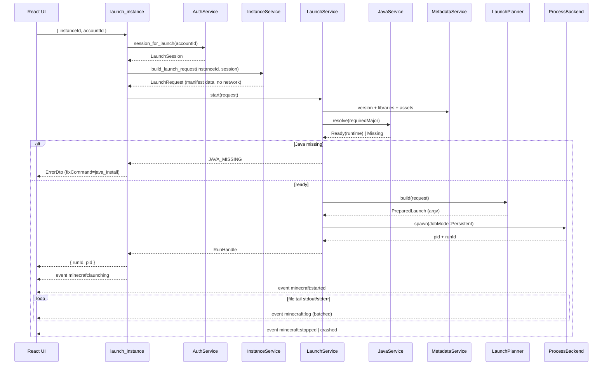

# IPC: команды NEXUS-launcher

**Версия документа:** 1.0
**Версия IPC-контракта:** `1`
**Дата:** 21.11.2026
**Статус:** проект. Реализация не начата.
**Связанные документы:** `docs/ARCHITECTURE.md`, `docs/EVENTS.md`,
`docs/DATABASE.md`.

---

## 1. Правила IPC

| № | Правило |
|---|---|
| C1 | Каждая команда — типизированный `#[tauri::command]` с request/response DTO |
| C2 | Имена: `<domain>_<action>`, `snake_case`, стабильны после релиза |
| C3 | DTO на границе — `camelCase`; внутри Rust — `snake_case` |
| C4 | Любая команда возвращает `Result<T, ErrorDto>` |
| C5 | Долгая операция (> 10 с или непредсказуемая) возвращает `{ jobId }` и работает в фоне |
| C6 | Прогресс и смена состояния — только событиями; команда не «ждёт» прогресс |
| C7 | Frontend не передаёт абсолютные пути для записи; только выбор пользователя в диалоге |
| C8 | Все аргументы валидируются в Rust; данные UI не считаются доверенными |
| C9 | Секреты никогда не входят в request/response DTO |
| C10 | Ошибки не содержат SQL, тел HTTP, полных путей и стектрейсов |
| C11 | Команды идемпотентны там, где это возможно; неидемпотентные UI не повторяет автоматически |
| C12 | События не заменяют команды: после события UI перезапрашивает состояние |

### 1.1. Синхронные и фоновые команды

- **S (sync)** — возвращает результат. Верхняя граница ~10 с; UI показывает
  локальный busy-state. Исключение: сетевые read-only запросы (каталог,
  поиск, манифест) могут длиться до 30 с — это таймаут источника, а не
  фоновая операция.
- **J (job)** — возвращает `JobAccepted { jobId }`; результат и прогресс — в
  событиях `job:*` и доменных событиях. UI может отменить через
  `jobs_cancel`.

Долгие операции, которые всегда являются job-ами: установка, клонирование,
импорт/экспорт, проверка целостности, установка Java, бэкап/restore, экспорт
диагностики.

### 1.2. Формат ошибки

```json
{
  "code": "INSTANCE_NOT_FOUND",
  "message": "Инстанс не найден.",
  "details": { "instanceId": "0193..." },
  "retryable": false,
  "requestId": "0f0a7f6e-9f6e-4f2b-9f0e-6f7f5f4f3f2e"
}
```

- `message` — готовый пользовательский текст (русский), без технических
  деталей.
- `details` — только идентификаторы и безопасные значения.
- `requestId` — всегда; коррелирует с логом.
- `retryable` — подсказка UI показать «Повторить».

Полный реестр кодов — §4.

### 1.3. Job-модель

```json
{
  "jobId": "0193...",
  "kind": "instance.install",
  "entity": { "kind": "instance", "id": "0193..." }
}
```

Общие события:

```text
job:started   { jobId, kind, entity, startedAt }
job:progress  { jobId, stage, done, total, unit, message? }
job:finished  { jobId, outcome: "succeeded", durationMs }
job:failed    { jobId, error: ErrorDto }
job:cancelled { jobId }
```

Правила job-ов:

- один `jobId` на пользовательскую операцию;
- прогресс троттлится до 10 Гц;
- отмена кооперативная: `jobs_cancel` → `CancellationToken` → стадия
  проверяет отмену; частичный результат откатывается или помечается;
- при рестарте приложения `running` → `interrupted`, UI показывает
  «прервано»;
- вложенные job-ы запрещены: загрузки имеют свои `downloadTaskId`, но
  агрегируются в прогресс родительского job-а.

### 1.4. Версионирование

- `IPC_SCHEMA_VERSION = 1` в `app_info`.
- Добавление необязательного поля — обратно совместимо.
- Удаление/переименование поля — новая версия схемы и миграционный период.
- Frontend и Rust собираются вместе; расхождение версий — ошибка сборки, а
  не runtime-сюрприз.

---

## 2. Карта команд по модулям

| Домен | Модуль Rust | Файл команд |
|---|---|---|
| `app_*`, `settings_*`, `jobs_*` | Core, Configuration | `commands/app.rs`, `settings.rs`, `jobs.rs` |
| `instances_*` | Instance Manager | `commands/instances.rs` |
| `minecraft_*` | Metadata, Installer | `commands/minecraft.rs` |
| `loaders_*` | Mod Loaders | `commands/loaders.rs` |
| `java_*`, `launch_*` | Java, Launch Engine | `commands/java.rs`, `launch.rs` |
| `accounts_*` | Authentication | `commands/accounts.rs` |
| `mods_*` | Mod Manager | `commands/mods.rs` |
| `modpacks_*` | Modpack Manager | `commands/modpacks.rs` |
| `downloads_*` | Download Manager | `commands/downloads.rs` |
| `servers_*` | Server Manager | `commands/servers.rs` |
| `nexus_*` | Workspace Integration | `commands/nexus.rs` |
| `backups_*` | Backup Manager | `commands/backups.rs` |
| `diagnostics_*` | Diagnostics | `commands/diagnostics.rs` |

---

## 3. Команды

### 3.1. Приложение и настройки

| Команда | Режим | Запрос → ответ | Примечание |
|---|---|---|---|
| `app_info` | S | `()` → `AppInfo` | Версии, data dir (сокращённый), схема IPC |
| `app_bootstrap` | S | `()` → `BootstrapDto` | Агрегат для холодного старта: info, settings, activeAccount, jobs, healthSummary |
| `settings_get` | S | `()` → `EffectiveSettings` | Bootstrap + app_settings |
| `settings_update` | S | `SettingsPatch` → `EffectiveSettings` | Валидация; `requiresRestart[]` |
| `settings_reset_group` | S | `{ group }` → `EffectiveSettings` | Сброс группы к default |
| `jobs_list` | S | `{ activeOnly?: bool, limit?: u32 }` → `JobDto[]` | История из БД + активные |
| `jobs_cancel` | S | `{ jobId }` → `CancelReceipt` | `accepted`, `alreadyFinished` |

`AppInfo`:

```json
{
  "version": "0.1.0",
  "tauriVersion": "2.12.x",
  "ipcSchemaVersion": 1,
  "dbSchemaVersion": 1,
  "dataDirDisplay": "%LOCALAPPDATA%\\NEXUS-Launcher",
  "os": "windows",
  "arch": "x86_64",
  "singleInstance": true
}
```

### 3.2. Инстансы

| Команда | Режим | Запрос → ответ | Примечание |
|---|---|---|---|
| `instances_list` | S | `{ includeArchived?: bool }` → `InstanceSummary[]` | Из БД, сверка с манифестами лениво |
| `instances_get` | S | `{ instanceId }` → `InstanceDetail` | Манифест + lock summary + источник |
| `instances_create` | S | `CreateInstanceRequest` → `InstanceDetail` | id генерирует Rust |
| `instances_update` | S | `{ instanceId, patch }` → `InstanceDetail` | Не меняет версию/загрузчик |
| `instances_clone` | J | `{ instanceId, name }` → `JobAccepted` | Полная независимая копия |
| `instances_change_version` | J | `{ instanceId, gameVersion, loader, loaderVersion, confirm: true }` → `JobAccepted` | Переустановка; смена MC/loader |
| `instances_delete` | S | `{ instanceId, mode: "permanent", confirmName }` → `DeleteReceipt` | Требует ввода имени |
| `instances_archive` | S | `{ instanceId, archived: bool }` → `InstanceDetail` | Не удаляет файлы |
| `instances_set_icon` | S | `{ instanceId, sourcePath }` → `InstanceDetail` | Путь из диалога; PNG/JPEG, ≤ 2 МБ |
| `instances_validate` | J | `{ instanceId }` → `JobAccepted` | Сверка lock/файлов; результат — `instance:validated` |
| `instances_install` | J | `{ instanceId }` → `JobAccepted` | MC + loader по манифесту |
| `instances_repair` | J | `{ instanceId }` → `JobAccepted` | Докачка/переустановка повреждённого |
| `instances_export` | J | `ExportInstanceRequest` → `JobAccepted` | `.mrpack`/raw zip; результат — `instance:exported` |

`CreateInstanceRequest`:

```json
{
  "name": "Fabric Survival",
  "gameVersion": "1.21.1",
  "loader": { "type": "fabric", "version": "0.16.9" },
  "memory": { "minMb": 1024, "maxMb": 4096 },
  "java": { "mode": "auto" },
  "description": ""
}
```

`InstanceSummary`:

```json
{
  "id": "0193...",
  "name": "Fabric Survival",
  "gameVersion": "1.21.1",
  "loader": { "type": "fabric", "version": "0.16.9" },
  "iconPresent": true,
  "archived": false,
  "installState": "installed",
  "lastPlayedAt": 1795274960000,
  "source": { "kind": "local" }
}
```

Ошибки: `INSTANCE_NOT_FOUND`, `INSTANCE_EXISTS`, `INSTANCE_INVALID`,
`INSTANCE_SCHEMA_TOO_NEW`, `INSTANCE_RUNNING`, `INSTANCE_LOCKED`, `CONFLICT`,
`DISK_SPACE`.

### 3.3. Minecraft и загрузчики

| Команда | Режим | Запрос → ответ | Примечание |
|---|---|---|---|
| `minecraft_versions` | S | `{ refresh?: bool }` → `VersionCatalogDto` | Кэш + ETag; офлайн — stale |
| `minecraft_version` | S | `{ versionId }` → `VersionDetailDto` | Java, libraries count, assets |
| `minecraft_cache_status` | S | `()` → `CacheStatusDto` | Размеры shared/cache |
| `minecraft_cache_clear` | J | `{ scope: "metadata"|"downloads" }` → `JobAccepted` | Не трогает shared versions |
| `loaders_versions` | S | `{ minecraftVersion, loader }` → `LoaderVersionDto[]` | `quilt`/`neoforge` — статус `unavailable` |

Установка загрузчика не является отдельной командой: она часть
`instances_install` / `servers_install`. Это исключает расхождение манифеста и
файлов.

`VersionDetailDto` содержит `javaMajor`, `mainClass`, `assetIndex`,
`clientJarSize`, `libraries` (агрегированно), `urlSource` — без прямых ссылок
для UI.

Ошибки: `METADATA_UNAVAILABLE`, `METADATA_INVALID`, `VERSION_NOT_FOUND`,
`LOADER_UNAVAILABLE`, `LOADER_VERSION_NOT_FOUND`, `NETWORK`.

### 3.4. Java

| Команда | Режим | Запрос → ответ | Примечание |
|---|---|---|---|
| `java_runtimes` | S | `()` → `JavaRuntimeDto[]` | Из БД + проверка пути |
| `java_detect` | J | `{ deep?: bool }` → `JobAccepted` | PATH, реестр, каталоги; результат — `java:runtimes-changed` |
| `java_register_path` | S | `{ path }` → `JavaRuntimeDto` | Путь из диалога; probe обязателен |
| `java_install` | J | `{ major, arch? }` → `JobAccepted` | Adoptium, checksum |
| `java_remove` | S | `{ runtimeId }` → `RemovalReceipt` | Запрещено, если используется |

`JavaRuntimeDto`:

```json
{
  "id": "0193...",
  "vendor": "Eclipse Temurin",
  "major": 25,
  "arch": "x64",
  "pathDisplay": "…\\java\\temurin-25-x64\\bin\\java.exe",
  "source": "managed",
  "verifiedAt": 1795274960000
}
```

Ошибки: `JAVA_NOT_FOUND`, `JAVA_INCOMPATIBLE`, `JAVA_ARCH_UNSUPPORTED`,
`JAVA_INSTALL_FAILED`, `JAVA_IN_USE`, `INTEGRITY_MISMATCH`.

### 3.5. Запуск игры

| Команда | Режим | Запрос → ответ | Примечание |
|---|---|---|---|
| `launch_preflight` | S | `{ instanceId }` → `LaunchReadiness` | Java, установка, аккаунт, память, диск |
| `launch_instance` | S | `{ instanceId, accountId? }` → `LaunchStarted` | После spawn; может занять до 10 с |
| `launch_stop` | S | `{ runId, force?: bool }` → `StopReceipt` | Force — только с подтверждением UI |
| `launch_status` | S | `{ runId }` → `RunStatusDto` | Для восстановления после навигации |
| `launch_active` | S | `()` → `RunStatusDto[]` | Активные запуски |

`LaunchReadiness`:

```json
{
  "ready": false,
  "issues": [
    { "code": "JAVA_MISSING", "message": "Требуется Java 25.", "fixCommand": "java_install" },
    { "code": "INSTALL_INCOMPLETE", "message": "Файлы версии не установлены.", "fixCommand": "instances_install" }
  ],
  "resolvedJava": { "major": 25, "runtimeId": "0193..." },
  "account": { "id": "0193...", "kind": "microsoft", "username": "Player" }
}
```

`LaunchStarted { runId, pid, instanceId }`.

Ошибки: `LAUNCH_NOT_INSTALLED`, `LAUNCH_JAVA_MISSING`,
`LAUNCH_INVALID_ARGUMENT`, `LAUNCH_SPAWN_FAILED`, `INSTANCE_RUNNING`,
`INSTANCE_NOT_RUNNING`, `AUTH_NO_ACTIVE_ACCOUNT`.

### 3.6. Аккаунты

| Команда | Режим | Запрос → ответ | Примечание |
|---|---|---|---|
| `accounts_list` | S | `()` → `AccountDto[]` | Без токенов |
| `accounts_active` | S | `()` → `AccountDto \| null` | |
| `accounts_set_active` | S | `{ accountId }` → `AccountDto` | |
| `accounts_begin_login` | S | `{ provider: "microsoft" }` → `LoginChallengeDto` | Poll идёт в фоне |
| `accounts_cancel_login` | S | `{ challengeId }` → `()` | |
| `accounts_create_offline` | S | `{ username }` → `AccountDto` | Явно помечен offline |
| `accounts_refresh` | S | `{ accountId }` → `AccountDto` | Таймаут 15 с |
| `accounts_remove` | S | `{ accountId }` → `RemovalReceipt` | Удаляет секрет из keyring |

`LoginChallengeDto`:

```json
{
  "challengeId": "0193...",
  "provider": "microsoft",
  "userCode": "ABCD-EFGH",
  "verificationUri": "https://microsoft.com/link",
  "expiresAt": 1795275260000
}
```

`AccountDto`:

```json
{
  "id": "0193...",
  "provider": "microsoft",
  "username": "Player",
  "uuid": "069a79f4-44e9-4726-a5be-fca90e38aaf5",
  "displayName": "Player",
  "status": "active",
  "kindLabel": "Microsoft",
  "lastUsedAt": 1795274960000
}
```

Ошибки: `AUTH_UNAVAILABLE`, `AUTH_FAILED`, `AUTH_EXPIRED`, `AUTH_CANCELLED`,
`AUTH_NO_ENTITLEMENT`, `AUTH_SECRET_STORE`, `RATE_LIMITED`.

### 3.7. Моды

| Команда | Режим | Запрос → ответ | Примечание |
|---|---|---|---|
| `mods_search` | S | `SearchModsRequest` → `SearchPageDto` | Modrinth; кэш/backoff |
| `mods_project` | S | `{ provider?, projectId }` → `ProjectDto` | |
| `mods_versions` | S | `ModVersionsRequest` → `ProjectVersionDto[]` | Фильтр MC/loader |
| `mods_plan_install` | S | `ModInstallRequest` → `ModInstallPlanDto` | Без изменений на диске |
| `mods_install` | J | `{ planId }` → `JobAccepted` | План живёт в памяти job-а (TTL 15 мин) |
| `mods_remove` | S | `{ instanceId, fileIds[] }` → `ModChangeReceipt` | С backup |
| `mods_set_enabled` | S | `{ instanceId, fileId, enabled }` → `InstalledModDto` | `.jar` ↔ `.jar.disabled` |
| `mods_installed` | S | `{ instanceId }` → `InstalledModDto[]` | |
| `mods_check_updates` | J | `{ instanceId }` → `JobAccepted` | Результат — `mods:updates-checked` |
| `mods_update` | J | `{ instanceId, updates: UpdateSelection }` → `JobAccepted` | Только выбранные |

`ModInstallRequest`:

```json
{
  "instanceId": "0193...",
  "provider": "modrinth",
  "projectId": "sodium",
  "versionId": "mc1.21.1-0.6.5",
  "includeOptionalDependencies": false
}
```

`ModInstallPlanDto`:

```json
{
  "planId": "0193...",
  "project": { "name": "Sodium", "version": "0.6.5" },
  "steps": [
    { "kind": "download", "name": "Sodium 0.6.5", "size": 1234567 },
    { "kind": "download", "name": "Fabric API 0.102.0", "size": 2345678, "dependency": true }
  ],
  "warnings": [],
  "conflicts": [],
  "totalBytes": 3580245
}
```

Ошибки: `MOD_NOT_FOUND`, `MOD_INCOMPATIBLE`, `MOD_DEPENDENCY_MISSING`,
`MOD_DEPENDENCY_CONFLICT`, `MOD_CONFLICT`, `MOD_ROLLBACK_FAILED`,
`RATE_LIMITED`, `OFFLINE`.

### 3.8. Модпаки

| Команда | Режим | Запрос → ответ | Примечание |
|---|---|---|---|
| `modpacks_inspect` | S | `{ archivePath }` → `ModpackInspectionDto` | Путь из диалога; только чтение |
| `modpacks_plan_import` | S | `{ inspectionId, name? }` → `ImportPlanDto` | Без изменений |
| `modpacks_import` | J | `{ planId }` → `JobAccepted` | Создаёт инстанс |
| `modpacks_export` | J | `{ instanceId, format, destinationPath }` → `JobAccepted` | Только выбранный файл |

`ModpackInspectionDto`:

```json
{
  "inspectionId": "0193...",
  "format": "mrpack",
  "name": "Create Expert",
  "minecraftVersion": "1.20.1",
  "loader": { "type": "forge", "version": "47.4.10" },
  "fileCount": 87,
  "overrideCount": 12,
  "totalBytes": 123456789,
  "warnings": [{ "code": "OPTIONAL_FILES", "message": "3 необязательных файла" }]
}
```

Ошибки: `MODPACK_UNSUPPORTED`, `MODPACK_INVALID`, `MODPACK_UNSAFE`,
`MODPACK_IMPORT_FAILED`, `MODPACK_ROLLBACK_FAILED`, `DISK_SPACE`,
`MOD_DEPENDENCY_MISSING`.

### 3.9. Загрузки

| Команда | Режим | Запрос → ответ | Примечание |
|---|---|---|---|
| `downloads_list` | S | `{ status?: string }` → `DownloadTaskDto[]` | |
| `downloads_pause` | S | `{ taskId }` → `DownloadTaskDto` | |
| `downloads_resume` | S | `{ taskId }` → `DownloadTaskDto` | |
| `downloads_cancel` | S | `{ taskId }` → `DownloadTaskDto` | Удаляет staging |
| `downloads_retry` | S | `{ taskId }` → `DownloadTaskDto` | Сбрасывает ошибку |
| `downloads_remove` | S | `{ taskId }` → `()` | Только завершённые/отменённые |
| `downloads_clear_finished` | S | `()` → `{ removed: u32 }` | |

`DownloadTaskDto`:

```json
{
  "id": "0193...",
  "kind": "minecraft",
  "label": "Minecraft 26.2",
  "status": "running",
  "filesDone": 41,
  "filesTotal": 124,
  "bytesDone": 25000000,
  "bytesTotal": 60500000,
  "speedBps": 4200000,
  "etaSeconds": 8,
  "errorCode": null,
  "jobId": "0193..."
}
```

Ошибки: `DOWNLOAD_FAILED`, `DOWNLOAD_HASH_MISMATCH`,
`DOWNLOAD_SIZE_MISMATCH`, `DOWNLOAD_CANCELLED`, `DOWNLOAD_DISK_FULL`,
`DOWNLOAD_URL_REJECTED`, `NOT_FOUND`.

### 3.10. Серверы

| Команда | Режим | Запрос → ответ | Примечание |
|---|---|---|---|
| `servers_list` | S | `()` → `ServerSummaryDto[]` | Статус из runtime |
| `servers_get` | S | `{ serverId }` → `ServerDetailDto` | |
| `servers_create` | S | `CreateServerRequest` → `ServerDetailDto` | EULA не принимается |
| `servers_update` | S | `{ serverId, patch }` → `ServerDetailDto` | Не меняет версию/loader |
| `servers_delete` | S | `{ serverId, confirmName }` → `DeleteReceipt` | Требует остановки |
| `servers_install` | J | `{ serverId }` → `JobAccepted` | Результат — `server:installed` |
| `servers_start` | S | `{ serverId }` → `ServerStatusDto` | Spawn; до 10 с |
| `servers_stop` | J | `{ serverId, force?: bool }` → `JobAccepted` | Мягкая остановка до 30 с |
| `servers_kill` | S | `{ serverId, confirm: true }` → `ServerStatusDto` | Принудительно |
| `servers_restart` | J | `{ serverId }` → `JobAccepted` | Stop → start |
| `servers_status` | S | `{ serverId }` → `ServerStatusDto` | CPU/RAM/uptime/PID |
| `servers_console_tail` | S | `{ serverId, afterSeq?, limit? }` → `ConsolePageDto` | ≤ 500 строк |
| `servers_send_command` | S | `{ serverId, command }` → `CommandReceipt` | Одна строка ≤ 512 |
| `servers_properties_get` | S | `{ serverId }` → `ServerPropertiesDto` | |
| `servers_properties_update` | S | `{ serverId, patch }` → `ServerPropertiesDto` | Валидация + `.bak` |
| `servers_players_get` | S | `{ serverId }` → `PlayerSnapshotDto` | 5 JSON-файлов |
| `servers_apply_player_op` | S | `{ serverId, op }` → `PlayerSnapshotDto` | op/add/remove/ban/op |
| `servers_accept_eula` | S | `{ serverId, accepted: bool }` → `EulaStateDto` | Явное действие |

`CreateServerRequest`:

```json
{
  "name": "Survival",
  "gameVersion": "1.21.1",
  "loader": { "type": "fabric", "version": "0.16.9" },
  "memoryMb": 4096,
  "port": 25565,
  "java": { "mode": "auto" },
  "autoRestart": { "enabled": false }
}
```

`ServerStatusDto`:

```json
{
  "serverId": "0193...",
  "state": "running",
  "pid": 12345,
  "uptimeSeconds": 3600,
  "cpuPercent": 12.4,
  "memoryBytes": 2147483648,
  "playersOnline": 3,
  "consoleReadOnly": false,
  "eulaAccepted": true
}
```

Ошибки: `SERVER_NOT_FOUND`, `SERVER_NOT_INSTALLED`, `EULA_REQUIRED`,
`SERVER_RUNNING`, `SERVER_NOT_RUNNING`, `SERVER_START_FAILED`,
`SERVER_PORT_BUSY`, `SERVER_RUN_LOST`, `SERVER_SCHEMA_TOO_NEW`,
`INVALID_ARGUMENT`.

### 3.11. NEXUS Workspace

| Команда | Режим | Запрос → ответ | Примечание |
|---|---|---|---|
| `nexus_sources_list` | S | `()` → `NexusSourceDto[]` | |
| `nexus_sources_add` | S | `AddNexusSourceRequest` → `NexusSourceDto` | URL валидируется |
| `nexus_sources_update` | S | `{ sourceId, patch }` → `NexusSourceDto` | |
| `nexus_sources_remove` | S | `{ sourceId }` → `RemovalReceipt` | Запрещено при установленных сборках |
| `nexus_connection_check` | S | `{ sourceId }` → `ConnectionStatusDto` | Каталог = проверка |
| `nexus_catalog` | S | `{ sourceId, channel, refresh? }` → `NexusCatalogDto` | |
| `nexus_versions` | S | `{ sourceId, packId, channel }` → `NexusVersionDto[]` | |
| `nexus_manifest` | S | `{ sourceId, packId, version, channel }` → `NexusManifestDto` | Только чтение |
| `nexus_install` | J | `{ sourceId, packId, version, channel, name? }` → `JobAccepted` | Создаёт инстанс |
| `nexus_check_updates` | S | `{ instanceId }` → `BuildUpdateCheckDto` | Без автообновления |
| `nexus_update` | J | `{ instanceId }` → `JobAccepted` | По кнопке; результат — `nexus:updated` |

`NexusManifestDto` (усечённо):

```json
{
  "manifestVersion": 1,
  "packId": "vanilla",
  "version": "1.1",
  "channel": "stable",
  "minecraft": { "version": "26.2", "loader": "fabric", "loaderVersion": "0.20.1" },
  "java": { "major": 25 },
  "fileCount": 124,
  "totalBytes": 60500000,
  "settings": { "memoryMb": null }
}
```

Ошибки: `NEXUS_SOURCE_INVALID`, `NEXUS_UNREACHABLE`,
`NEXUS_CONTRACT_MISMATCH`, `NEXUS_MANIFEST_INVALID`,
`NEXUS_LOADER_UNSUPPORTED`, `NEXUS_PRIVATE_UNAVAILABLE`,
`NEXUS_UPDATE_CONFLICT`, `OFFLINE`.

### 3.12. Бэкапы

| Команда | Режим | Запрос → ответ | Примечание |
|---|---|---|---|
| `backups_list` | S | `{ targetKind?, targetId? }` → `BackupDto[]` | |
| `backups_create` | J | `CreateBackupRequest` → `JobAccepted` | |
| `backups_restore` | J | `{ backupId, confirm: true }` → `JobAccepted` | Pre-restore snapshot |
| `backups_delete` | S | `{ backupId, confirm: true }` → `()` | |
| `backups_verify` | J | `{ backupId }` → `JobAccepted` | Результат — `backup:verified` |

`CreateBackupRequest`:

```json
{
  "target": { "kind": "instance", "id": "0193..." },
  "mode": "full",
  "note": "Перед обновлением модов"
}
```

Ошибки: `BACKUP_TARGET_BUSY`, `BACKUP_INVALID`, `BACKUP_INTEGRITY`,
`BACKUP_RESTORE_REFUSED`, `BACKUP_DISK_FULL`, `NOT_FOUND`.

### 3.13. Диагностика

| Команда | Режим | Запрос → ответ | Примечание |
|---|---|---|---|
| `diagnostics_health` | S | `()` → `HealthReportDto` | Быстрые проверки |
| `diagnostics_log_sources` | S | `()` → `LogSourceDto[]` | launcher/game/server |
| `diagnostics_logs_query` | S | `LogQuery` → `LogPageDto` | Хвост файла, ≤ 1000 строк |
| `diagnostics_crashes_list` | S | `{ instanceId? }` → `CrashSummaryDto[]` | |
| `diagnostics_crash_read` | S | `{ crashId }` → `CrashReportDto` | Парсинг секций |
| `diagnostics_export` | J | `ExportDiagnosticsRequest` → `JobAccepted` | Только по действию |

`LogQuery`:

```json
{
  "source": { "kind": "instance", "id": "0193..." },
  "level": "warn",
  "search": "exception",
  "afterSeq": null,
  "limit": 200,
  "includeGameLog": true
}
```

Ошибки: `LOG_NOT_FOUND`, `CRASH_NOT_FOUND`, `EXPORT_FAILED`,
`DIAGNOSTICS_DISK_FULL`, `PERMISSION_DENIED`.

### 3.14. Системные диалоги

Команды не принимают произвольные пути для записи. Выбор файла выполняет
frontend через `@tauri-apps/plugin-dialog`:

- `open` — импорт `.mrpack`, `.zip`, выбор `java.exe`, иконки;
- `save` — экспорт модпака, диагностического пакета, бэкапа.

Полученный путь передаётся в соответствующую команду, где Rust:

1. канонизирует его;
2. проверяет тип (файл/каталог), расширение и размер;
3. проверяет, что чтение/запись не выходит за разрешённую операцию;
4. для записи использует только выбранный файл, не произвольный каталог.

---

## 4. Реестр ошибок

`retryable` — рекомендация UI, не автоматический retry.

### 4.1. Общие

| Код | Смысл | Retryable |
|---|---|---|
| `INVALID_ARGUMENT` | Нарушена форма запроса | нет |
| `INVALID_PATH` | Путь не прошёл валидацию | нет |
| `PATH_OUTSIDE_ROOT` | Попытка выйти за корень | нет |
| `RESERVED_NAME` | Зарезервированное имя Windows | нет |
| `PATH_COLLISION` | Коллизия без учёта регистра | нет |
| `NOT_FOUND` | Объект не найден | нет |
| `CONFLICT` | Конфликт состояния | нет |
| `UNSUPPORTED` | Операция не поддерживается | нет |
| `PERMISSION_DENIED` | Нет прав ОС | нет |
| `INTERNAL` | Внутренняя ошибка (есть `requestId`) | нет |
| `TIMEOUT` | Истёк таймаут | да |
| `NETWORK` | Сетевая ошибка | да |
| `OFFLINE` | Нет соединения | да |
| `RATE_LIMITED` | 429/лимит источника | да |
| `CANCELLED` | Операция отменена | нет |
| `DISK_SPACE` | Недостаточно места | нет |
| `INTEGRITY_MISMATCH` | Хэш/размер не совпал | да (1 повтор) |
| `JOB_NOT_FOUND` | Job не найден | нет |
| `JOB_BUSY` | Ресурс занят другим job-ом | нет |

### 4.2. Конфигурация и БД

| Код | Модуль |
|---|---|
| `CONFIG_INVALID` | Configuration |
| `CONFIG_WRITE_FAILED` | Configuration |
| `SETTINGS_INVALID` | Configuration |
| `SETTINGS_READ_ONLY` | Configuration |
| `SETTINGS_WRITE_FAILED` | Configuration |
| `DB_UNAVAILABLE` | Database |
| `DB_BUSY` | Database |
| `DB_MIGRATION_FAILED` | Database |
| `DB_SCHEMA_TOO_NEW` | Database |
| `DB_INTEGRITY` | Database |
| `DB_BACKUP_FAILED` | Database |
| `LOGGING_INIT_FAILED` | Logging |

### 4.3. Безопасность и авторизация

| Код | Модуль |
|---|---|
| `UNSAFE_PATH` | Security |
| `ARCHIVE_UNSAFE` | Security |
| `ARCHIVE_LIMIT` | Security |
| `URL_REJECTED` | Security |
| `TLS_REQUIRED` | Security |
| `SECRET_STORE_UNAVAILABLE` | Security |
| `AUTH_UNAVAILABLE` | Authentication |
| `AUTH_FAILED` | Authentication |
| `AUTH_EXPIRED` | Authentication |
| `AUTH_CANCELLED` | Authentication |
| `AUTH_NO_ENTITLEMENT` | Authentication |
| `AUTH_SECRET_STORE` | Authentication |
| `AUTH_NO_ACTIVE_ACCOUNT` | Authentication |

### 4.4. Игра

| Код | Модуль |
|---|---|
| `METADATA_UNAVAILABLE` | Metadata |
| `METADATA_INVALID` | Metadata |
| `VERSION_NOT_FOUND` | Metadata |
| `VERSION_INHERITANCE_CYCLE` | Metadata |
| `INSTALL_INVALID` | Installer |
| `INSTALL_LOCKED` | Installer |
| `NATIVES_EXTRACT` | Installer |
| `INSTANCE_NOT_FOUND` | Instances |
| `INSTANCE_EXISTS` | Instances |
| `INSTANCE_INVALID` | Instances |
| `INSTANCE_SCHEMA_TOO_NEW` | Instances |
| `INSTANCE_RUNNING` | Instances/Launch |
| `INSTANCE_NOT_RUNNING` | Launch |
| `INSTANCE_LOCKED` | Instances |
| `JAVA_NOT_FOUND` | Java |
| `JAVA_INCOMPATIBLE` | Java |
| `JAVA_ARCH_UNSUPPORTED` | Java |
| `JAVA_INSTALL_FAILED` | Java |
| `JAVA_IN_USE` | Java |
| `LAUNCH_NOT_INSTALLED` | Launch |
| `LAUNCH_JAVA_MISSING` | Launch |
| `LAUNCH_INVALID_ARGUMENT` | Launch |
| `LAUNCH_SPAWN_FAILED` | Launch |
| `LOADER_UNSUPPORTED` | Loaders |
| `LOADER_UNAVAILABLE` | Loaders |
| `LOADER_VERSION_NOT_FOUND` | Loaders |
| `LOADER_INCOMPATIBLE` | Loaders |
| `LOADER_INSTALL_FAILED` | Loaders |

### 4.5. Контент

| Код | Модуль |
|---|---|
| `MOD_NOT_FOUND` | Mods |
| `MOD_INCOMPATIBLE` | Mods |
| `MOD_DEPENDENCY_MISSING` | Mods |
| `MOD_DEPENDENCY_CONFLICT` | Mods |
| `MOD_CONFLICT` | Mods |
| `MOD_ROLLBACK_FAILED` | Mods |
| `MODPACK_UNSUPPORTED` | Modpacks |
| `MODPACK_INVALID` | Modpacks |
| `MODPACK_UNSAFE` | Modpacks |
| `MODPACK_IMPORT_FAILED` | Modpacks |
| `MODPACK_ROLLBACK_FAILED` | Modpacks |
| `DOWNLOAD_FAILED` | Downloads |
| `DOWNLOAD_HASH_MISMATCH` | Downloads |
| `DOWNLOAD_SIZE_MISMATCH` | Downloads |
| `DOWNLOAD_CANCELLED` | Downloads |
| `DOWNLOAD_DISK_FULL` | Downloads |
| `DOWNLOAD_URL_REJECTED` | Downloads |

### 4.6. Серверы, NEXUS, бэкапы, диагностика

| Код | Модуль |
|---|---|
| `SERVER_NOT_FOUND` | Servers |
| `SERVER_NOT_INSTALLED` | Servers |
| `SERVER_SCHEMA_TOO_NEW` | Servers |
| `EULA_REQUIRED` | Servers |
| `SERVER_RUNNING` | Servers |
| `SERVER_NOT_RUNNING` | Servers |
| `SERVER_START_FAILED` | Servers |
| `SERVER_PORT_BUSY` | Servers |
| `SERVER_RUN_LOST` | Servers |
| `SERVER_CONSOLE_UNAVAILABLE` | Servers |
| `SERVER_PROPS_INVALID` | Servers |
| `SERVER_PLAYER_OP_FAILED` | Servers |
| `NEXUS_SOURCE_INVALID` | Workspace |
| `NEXUS_UNREACHABLE` | Workspace |
| `NEXUS_CONTRACT_MISMATCH` | Workspace |
| `NEXUS_MANIFEST_INVALID` | Workspace |
| `NEXUS_LOADER_UNSUPPORTED` | Workspace |
| `NEXUS_PRIVATE_UNAVAILABLE` | Workspace |
| `NEXUS_UPDATE_CONFLICT` | Workspace |
| `BACKUP_TARGET_BUSY` | Backups |
| `BACKUP_INVALID` | Backups |
| `BACKUP_INTEGRITY` | Backups |
| `BACKUP_RESTORE_REFUSED` | Backups |
| `BACKUP_DISK_FULL` | Backups |
| `LOG_NOT_FOUND` | Diagnostics |
| `CRASH_NOT_FOUND` | Diagnostics |
| `EXPORT_FAILED` | Diagnostics |
| `DIAGNOSTICS_DISK_FULL` | Diagnostics |

---

## 5. Валидация на границе

### 5.1. Общие правила

- Строки: `.trim()`, NFC, отказ от `\0`, `\r`, `\n` (кроме консольной
  команды, где `\r`/`\n` запрещены), ограничение длины.
- ID: строгий UUID; `slug`/`packId`: allowlist из контракта.
- Числа: диапазоны из `docs/ARCHITECTURE.md` §8.1/§8.3.
- Enum: только известные значения; неизвестное — `INVALID_ARGUMENT`.
- Массивы: лимит элементов (например, `fileIds` ≤ 1000).
- Объекты patch: только известные поля; неизвестные игнорируются или
  отклоняются в зависимости от операции.

### 5.2. Пути

| Тип | Правило |
|---|---|
| `ImportPath` | Абсолютный, canonicalize, файл, расширение из allowlist, размер ≤ лимита, read-only |
| `ExportPath` | Абсолютный родительский каталог + безопасное имя; файл создаёт Rust |
| `IconPath` | PNG/JPEG, ≤ 2 МБ, проверка сигнатуры, копирование в `icon.png` |
| `JavaPath` | Файл `java.exe`/`javaw.exe`, запуск probe, запрет относительных путей |
| Внутренние файлы | Только `RootedDir` + `SafeRelPath`; UI не передаёт пути |

---

## 6. Пример: запуск игры



Ключевые свойства:

- до spawn выполняется preflight, после spawn команда не ждёт игру;
- логи идут событиями, не через команду;
- остановка — отдельная команда по `runId`;
- повторный запуск того же инстанса отклоняется `INSTANCE_RUNNING`.

---

## 7. Frontend-обёртки

Единственное место `invoke` — `frontend/src/services/ipc`.

```ts
// services/ipc/instances.ts
import { invoke } from "@tauri-apps/api/core";
import type { InstanceDetail, InstanceSummary, CreateInstanceRequest } from "@/types/ipc";

export const instances = {
  list: (includeArchived = false) =>
    invoke<InstanceSummary[]>("instances_list", { includeArchived }),

  create: (req: CreateInstanceRequest) =>
    invoke<InstanceDetail>("instances_create", { req }),

  install: (instanceId: string) =>
    invoke<{ jobId: string }>("instances_install", { instanceId }),
};
```

Правила:

- никаких `invoke("...", { path })` вне `services/ipc`;
- ошибки нормализуются в `IpcError`;
- события подписываются централизованно (`app/events.ts`);
- после `job:finished` соответствующий query-key инвалидируется.

---

## 8. Ограничения и открытые вопросы

| № | Вопрос | Решение |
|---|---|---|
| IPC-Q1 | Нужны ли idempotency keys | Нет в v1; UI не повторяет неидемпотентные команды |
| IPC-Q2 | Нужен ли агрегирующий `app_bootstrap` | Да, один вызов на старте |
| IPC-Q3 | Нужна ли команда `install_loader` | Нет: часть `instances_install`/`servers_install` |
| IPC-Q4 | Нужен ли `servers_metrics` отдельно | Нет: `servers_status` |
| IPC-Q5 | Нужна ли пагинация инстансов | Нет в v1 (десятки, не тысячи) |
| IPC-Q6 | Нужен ли typed IPC generator | Нет: ручные DTO + contract-тест схем |
