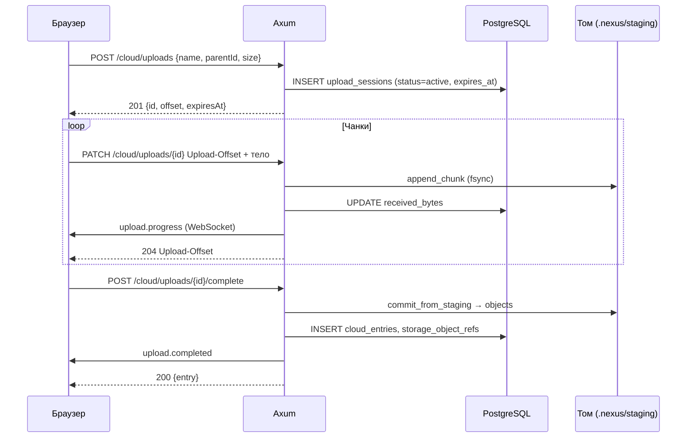
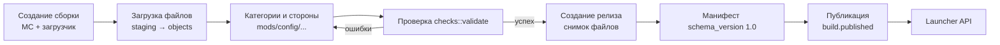
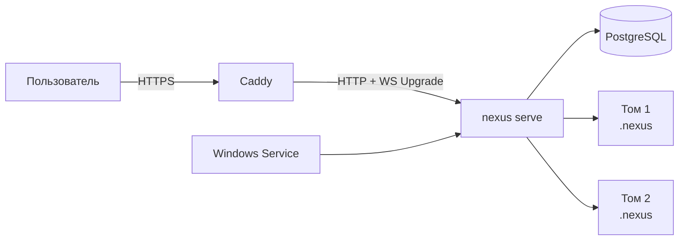
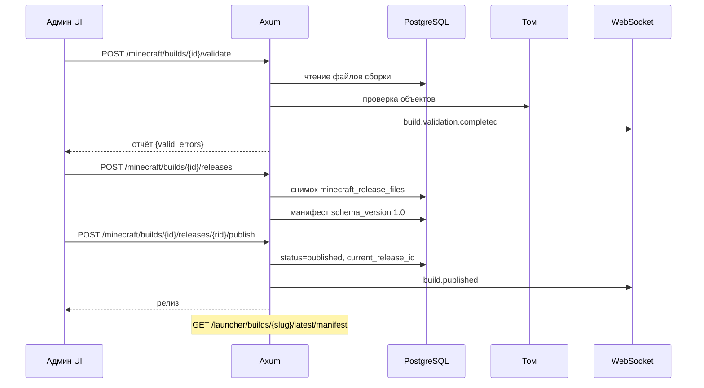
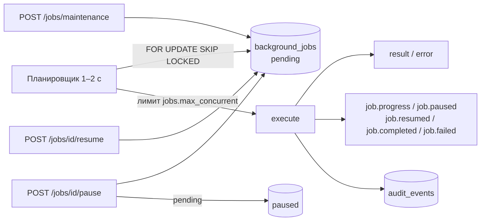

# Архитектура NEXUS WORKSPACE

Документ описывает фактическую архитектуру репозитория на 19.11.2026 и
соответствует коду в `backend/src`, `frontend/src`, `backend/migrations`.
Требования ТЗ — `../MAIN_PLAN.md`; аудит готовности — `../COMPLETE.md`.
Расхождения плана и кода перечислены в разделе 17.

## 1. Назначение и границы

NEXUS WORKSPACE — модульный монолит: один процесс Rust обслуживает HTTP API,
WebSocket, фоновые задачи и раздачу собранного frontend. Внешних очередей,
Redis и отдельных сервисов нет; единственные внешние зависимости — PostgreSQL
и файловые тома хранения.

| Слой | Технология | Версия в манифесте |
|---|---|---|
| Backend | Rust, edition 2024, MSRV 1.85 | `backend/Cargo.toml` |
| HTTP | Axum 0.8, Tokio 1, Tower/Tower-HTTP 0.6 | `backend/Cargo.toml` |
| БД | PostgreSQL, SQLx 0.8 (rustls, migrate) | `backend/Cargo.toml` |
| Frontend | React 19, TypeScript 5.9, Vite 7 | `frontend/package.json` |
| Состояние UI | Zustand 5, TanStack Query 5 | `frontend/package.json` |
| 3D-фон | Three.js 0.179 | `frontend/package.json` |
| Тесты | cargo test, Vitest 5, Testing Library | `backend/tests`, `frontend/src` |

## 2. Карта модулей

Модуль — каталог в `backend/src`; каждый содержит обработчики (`routes.rs`),
сервисную логику и SQLx-запросы. Обработчик не обращается к файловой системе
напрямую: этим занимается `storage::engine`.

| Модуль | Файлы | Ответственность | Зависит от |
|---|---|---|---|
| `api` | `api/mod.rs`, `api/openapi/` | Конверт `success/data`, `Page`, пагинация, реестр OpenAPI по доменам | — |
| `core` | `core/error.rs`, `core/idempotency.rs`, `core/tickets.rs` | `ApiError`/`ApiResult`, `Idempotency-Key`, HMAC-тикеты публичных ссылок | — |
| `config` | `config.rs` | `nexus.toml` + переменные окружения, валидация | — |
| `database` | `database.rs` | Пул SQLx, миграции, синхронизация каталога прав | `config`, `permissions` |
| `middleware` | `middleware.rs` | request id, CSRF, гейт модулей, метрики, IP прокси | `auth`, `state` |
| `state` | `state.rs` | `AppState`: пул, конфиг, кеши (модули, сессии), лимитеры, блокировки загрузок, realtime | все модули |
| `auth` | `auth/session.rs`, `auth/password.rs`, `auth/rate_limit.rs`, `auth/routes.rs`, `auth/extract.rs` | Сессии, cookie, CSRF, Argon2id, вход/выход, извлечение `AuthUser` | `core`, `state` |
| `users` | `users/routes.rs`, `users/service.rs`, `users/cli.rs` | Пользователи, роли, статусы, сброс пароля, квоты, CLI | `auth`, `permissions` |
| `permissions` | `permissions/catalog.rs`, `permissions/routes.rs` | Каталог 20 прав, роли, CRUD ролей | `core` |
| `storage` | `storage/engine.rs`, `paths.rs`, `disks.rs`, `hashing.rs`, `service.rs`, `routes.rs`, `http.rs`, `objects.rs`, `quota.rs`, `cli.rs` | Тома, объекты, SHA-256, защита путей, проверка дисков, общие HTTP/квоты и CLI | `core` |
| `cloud` | `cloud/routes.rs`, `service.rs`, `uploads.rs`, `shares.rs`, `exports.rs`, `quota.rs`, `files.rs` | Файлы, папки, возобновляемые загрузки, ссылки, ZIP, корзина | `storage`, `realtime`, `core` |
| `minecraft` | `minecraft/builds.rs`, `files.rs`, `uploads.rs`, `checks.rs`, `validation.rs`, `releases.rs`, `manifests.rs`, `metadata.rs`, `routes.rs` | Сборки, файлы, проверка, релизы, манифесты, метаданные загрузчиков | `storage`, `realtime` |
| `launcher` | `launcher/tokens.rs`, `catalog.rs`, `artifacts.rs`, `downloads.rs`, `routes.rs` | Bearer-токены и scopes, каталог, манифесты, артефакты, лимиты частоты и параллельных скачиваний | `storage`, `state` |
| `realtime` | `realtime/mod.rs` | WebSocket, адресная рассылка, лимит соединений | `auth`, `state` |
| `system` | `system/routes.rs`, `settings.rs`, `settings_catalog.rs`, `settings_cache.rs`, `monitoring.rs`, `monitoring_routes.rs`, `jobs.rs`, `jobs_routes.rs`, `audit.rs`, `requests.rs` | Настройки, мониторинг, журнал, фоновые задачи, метрики API | `core`, `realtime`, `storage`, `cloud` |

Маршрутизация собирается в `build_router`
([`backend/src/lib.rs`](../backend/src/lib.rs)):

```text
/api/v1
├── /health, /ws, /openapi.json, /docs
├── /auth, /users, /roles, /permissions, /me
├── /storage
├── /cloud, /public/shares
├── /minecraft, /launcher, /admin/launcher
├── /monitoring, /jobs, /system
└── fallback → 404 в формате ApiError
```

Всего 116 вызовов `.route(`; реестр `api::openapi::OPERATIONS` сверяется с ними
тестом [`backend/tests/openapi_tests.rs`](../backend/tests/openapi_tests.rs).
Операции OpenAPI разложены по доменам в `backend/src/api/openapi/`, сборка
документа — в `document.rs`.

`minecraft` и `launcher` не импортируют `crate::cloud`: общие операции
(`stream_object`, `delete_zero_ref_objects`, квоты) живут в `storage`.
Граница проверяется архитектурным тестом
[`backend/tests/module_boundaries_tests.rs`](../backend/tests/module_boundaries_tests.rs).

## 3. Жизненный цикл запроса

Порядок слоёв соответствует вызовам `.layer()` в `build_router`; внешний слой
указан первым.

1. `request_metrics` — счётчик in-flight, RPS, задержка, доля 5xx.
2. `request_context` — принимает или генерирует `x-request-id`, повторяет его
   в ответе и в теле JSON-ошибки.
3. `TraceLayer` — структурный журнал запроса.
4. Заголовки безопасности: CSP, `X-Frame-Options`, `X-Content-Type-Options`,
   `Referrer-Policy`, `Permissions-Policy`.
5. `DefaultBodyLimit` — 2 МБ для всего API; для `/cloud` и `/minecraft`
   технический лимит 256 МБ, фактический размер чанка проверяется в
   обработчике по `limits.chunk_max_mb`.
6. `CompressionLayer` (gzip) и CORS (если заданы origins).
7. `csrf_guard` — для изменяющих методов обязательны cookie-сессия и
   `x-csrf-token`; исключения: `auth/login`, `auth/setup-status`, `health`,
   `launcher/auth/token`, `launcher/auth/revoke`.
8. `module_guard` — отключённый модуль (`cloud`, `minecraft`/`launcher`/`admin`)
   возвращает `MODULE_DISABLED` (лаунчеру — 404).
9. Extractor `AuthUser` (`auth/extract.rs`) читает `nexus_session`, загружает
   пользователя, роли и права. Для лаунчера `LauncherClient`
   (`launcher/tokens.rs`) читает `Authorization: Bearer` и проверяет scopes.
10. Обработчик вызывает `actor.require("<permission>")`, затем сервис.
11. Сервис работает только через SQLx-пул и `storage::engine`.
12. Ответ оборачивается в `ApiOk` → `{ "success": true, "data": ... }`.
    Ошибка — `ApiError` → `{ "success": false, "error": {code, message, details},
    "request_id": "..." }`.

Публичные ссылки `/api/v1/public/shares/*` не требуют сессии: доступ
определяется токеном ссылки, сроком, паролем и лимитом скачиваний
(`cloud/shares.rs`). WebSocket `/api/v1/ws` авторизуется cookie-сессией,
но не проходит `csrf_guard`, потому что это `GET`.

## 4. Изоляция рабочих пространств

| Область | Владелец | Правило доступа |
|---|---|---|
| Cloud | `cloud_entries.user_id`, `upload_sessions.user_id` | Только владелец; публичная ссылка — отдельный токен |
| Minecraft | `minecraft_builds.owner_id` | Владелец правит сборку; роли с `minecraft.view` видят опубликованное |
| Launcher | `access_tokens.user_id` | Только scopes токена; каталог отдаёт публичные сборки |
| System | Глобально | Права `system.*`, суперадмин обходит проверки |

Права перечислены в [`backend/src/permissions/catalog.rs`](../backend/src/permissions/catalog.rs)
и синхронизируются в таблицу `permissions` при старте
(`database::sync_permission_catalog`). `AuthUser::can` возвращает `true`
суперадмину; UI использует тот же список прав из `/auth/me`.

Квоты: персональная `users.quota_bytes` приоритетнее значения
`quota_defaults` для области `cloud`/`minecraft`
([`backend/src/cloud/quota.rs`](../backend/src/cloud/quota.rs)). Проверка
выполняется до создания сессии загрузки; превышение — `413 QUOTA_EXCEEDED`
с `limitBytes`, `usedBytes`, `requestedBytes`.

## 5. Storage Engine

Исходные файлы: [`backend/src/storage/engine.rs`](../backend/src/storage/engine.rs),
[`paths.rs`](../backend/src/storage/paths.rs), [`hashing.rs`](../backend/src/storage/hashing.rs).
Схема таблиц — `backend/migrations/0002_storage.sql`.

```text
<root тома>/
└── .nexus/
    ├── objects/<2 hex>/<2 hex>/<sha-prefix>-<random-id>
    ├── staging/<upload-session-id>.part
    └── quarantine/<timestamp>-<file>
```

* Том регистрируется администратором; корень канонизируется, корень диска и
  системные каталоги запрещены.
* Пользовательский API не передаёт абсолютные пути. Относительные имена
  нормализуются: `..`, `\0`, абсолютные пути отклоняются.
* `ensure_no_links` проверяет каждый компонент пути на symlink/junction
  (Windows reparse point) и запрещает выход за корень.
* Загрузка пишется потоково в `staging`; `commit_from_staging` считает SHA-256,
  переносит файл в `objects`, затем в транзакции создаёт `storage_objects`.
  При ошибке БД файл уходит в `quarantine`.
* Состояния объекта: `staging`, `committed`, `quarantined`, `missing`
  (check-ограничение `storage_objects.state`).
* Ссылки: `storage_object_refs(object_id, owner_module, owner_id, display_name)`
  и `storage_objects.ref_count`. Удаление ссылки уменьшает счётчик;
  `cloud::service::delete_zero_ref_objects` физически удаляет объект только
  при `ref_count <= 0`. Поэтому файл, используемый несколькими записями,
  не пропадает при удалении одной из них.
* Выбор тома: явный `volumeId` либо авто-выбор по `priority desc,
  available_bytes desc` среди `enabled`, `online`, `mode = 'auto'` с учётом
  `reserved_bytes` и `max_bytes`.

## 6. Cloud Storage: загрузка и скачивание

Возобновляемая загрузка — собственная реализация с семантикой tus 1.0.0
([`backend/src/cloud/uploads.rs`](../backend/src/cloud/uploads.rs)):



Скачивание выполняется через `cloud/files.rs`: объект открывается как
`tokio::fs::File`, отдаётся потоком, поддерживается `Range` и
`Content-Disposition`. Прогресс публикуется с троттлингом (не чаще 4 раз/с,
для файлов от 16 МиБ — раз в 500 мс); при полной передаче приходит
`download.completed`, при обрыве — `download.failed`. Счётчик
`activeDownloads` уменьшается в `Drop` читателя, поэтому не «залипает».

Прочие элементы Cloud: папки и пакетное создание, замена файла с сохранением
старого объекта при ошибке, корзина (`cloud_trash` — view над
`cloud_entries.trashed_at`), публичные ссылки (`cloud_shares`), ZIP-экспорт
(`cloud_exports`), идемпотентность завершения загрузки.

## 7. Minecraft Build Manager и публикация релиза

Исходники: [`backend/src/minecraft/builds.rs`](../backend/src/minecraft/builds.rs),
`files.rs`, `uploads.rs`, `checks.rs`, `releases.rs`, `manifests.rs`.



* `minecraft_builds` хранит версию MC, загрузчик, Java, видимость, иконку
  (`icon_object_id`), статус и текущий релиз.
* Релиз — неизменяемый снимок: `minecraft_release_files` фиксирует путь,
  категорию, сторону, размер и SHA-256.
* Манифест строится только из снимка релиза. Файлы сортируются байтовым
  сравнением `path` в Rust (не зависит от локали/коллации БД), время
  генерации не включается. Поле `schema_version` остаётся `"1.0"`; новые
  поля добавляются только аддитивно (`docs/MANIFEST.md`, задача A5).
* Иконка входит в манифест необязательным полем `icon { url, sha256 }`
  (G1): SHA берётся из `storage_objects`, URL ведёт на лаунчерный эндпоинт.
  Для уже опубликованных релизов иконка добавляется только задачей
  `system.manifests.regenerate` с аудитом.

## 8. Launcher API

Исходники: [`backend/src/launcher/tokens.rs`](../backend/src/launcher/tokens.rs),
[`catalog.rs`](../backend/src/launcher/catalog.rs),
[`artifacts.rs`](../backend/src/launcher/artifacts.rs),
[`downloads.rs`](../backend/src/launcher/downloads.rs).

* `POST /api/v1/launcher/auth/token` — логин/пароль пользователя, выдача
  Bearer-токена. В БД хранится только SHA-256 токена.
* Scopes: `launcher.catalog`, `launcher.artifacts` (проверяются
  `LauncherClient::require`; без scopes суперадмин получает оба).
* Каталог, манифесты и иконка отдают публичные сборки и приватные сборки
  владельца токена (`CATALOG_SELECT`, F4). Чужой токен получает `404`.
* `GET /api/v1/launcher/builds/{slug}/icon` отдаёт изображение с типом по
  сигнатуре, `ETag` (SHA-256) и лимитом частоты.
* Артефакт отдаётся потоком с поддержкой `Range`; лимиты —
  `TokenBucketLimiter` на токен: каталог 120/мин, артефакты 600/мин (по
  умолчанию; всплеск равен минутному лимиту). Значения задаются секцией
  `[launcher]` в `nexus.toml` и переменными `NEXUS_LAUNCHER_RPM` /
  `NEXUS_LAUNCHER_ARTIFACTS_RPM`.
  Заголовки `X-RateLimit-Limit/Remaining/Reset` и `Retry-After` отдаются
  (`backend/src/launcher/routes.rs`). Параллельные скачивания ограничены
  семафором на токен (`max_parallel_downloads`, по умолчанию 8): permit
  удерживается `PermitStream` до конца потока или обрыва клиента, при
  исчерпании — `503 DOWNLOAD_LIMIT_REACHED` с `Retry-After`
  (`backend/src/launcher/downloads.rs`).
* Административные маршруты `/api/v1/admin/launcher/tokens` требуют
  браузерную сессию и право `launcher.manage`.

## 9. System Management

| Подсистема | Файлы | Факты |
|---|---|---|
| Настройки | `system/settings.rs`, `settings_catalog.rs`, `settings_cache.rs` | 17 ключей, типы/границы/`requiresRestart`, кеш с TTL 10 с и инвалидацией при записи |
| Мониторинг | `system/monitoring.rs`, `monitoring_routes.rs` | CPU, память, swap, сеть, диски, IO процесса, история в `system_metrics` |
| Метрики API | `system/requests.rs` | RPS, средняя задержка, доля ошибок, in-flight |
| Аудит | `system/audit.rs` | `audit_events`: событие, актор, цель, результат, IP, JSON-детали |
| Задачи | `system/jobs.rs`, `system/scheduler.rs`, `jobs_routes.rs` | Типы `system.storage.check`, `system.objects.verify`, `uploads.cleanup`, `shares.cleanup`, `metrics.prune`, `manifests.regenerate`, `idempotency.cleanup`, `cloud.export` |
| Модули | `system/routes.rs`, `state.rs` | `module_states` + кеш 5 с, гейт API |

Планировщик (`scheduler.rs`) — единственный потребитель очереди: цикл 1,5 с,
атомарный захват `FOR UPDATE SKIP LOCKED`, лимит из `jobs.max_concurrent`
(fallback 2), восстановление `running → pending` при старте.
`POST /jobs/maintenance` только создаёт запись `pending`; при graceful shutdown
новые задачи не берутся, текущим выставляется `cancel_requested`.
Пауза/возобновление — задача C3 (поля `pause_requested`/`paused_at` уже
добавлены миграцией C1).

## 10. Realtime-брокер

Исходник: [`backend/src/realtime/mod.rs`](../backend/src/realtime/mod.rs).

* `Hub` — `tokio::sync::broadcast` ёмкостью 512 событий. Медленный клиент
  получает `lagged` и продолжает работу.
* Каждое соединение получает приветствие `connected`, затем только
  адресованные события: `userId` совпадает с пользователем; системные
  (`userId = null`) — только при праве `system.monitoring.view`.
* Не более 3 соединений на пользователя (`MAX_CONNECTIONS_PER_USER`);
  четвёртое закрывает старейшее с кадром `closed`/`connection_limit`.
* Heartbeat — Ping каждые 30 с; отключение снимает соединение из реестра.

Публикуемые события (проверено по вызовам `publish_*`):

| Событие | Тип | Где |
|---|---|---|
| `connected`, `closed`, `lagged` | кадры соединения | `realtime/mod.rs` |
| `upload.progress` | пользовательское | `cloud/uploads.rs` |
| `upload.completed` | пользовательское | `cloud/routes.rs` |
| `upload.failed` | пользовательское | `cloud/uploads.rs`, `cloud/routes.rs`, `minecraft/uploads.rs` |
| `download.progress`, `download.completed`, `download.failed` | пользовательское | `cloud/files.rs` |
| `job.progress`, `job.paused`, `job.resumed`, `job.completed`, `job.failed`, `job.cancelled` | системное | `system/jobs.rs`, `system/jobs_routes.rs` |
| `build.validation.completed` | системное | `minecraft/routes.rs` |
| `build.published`, `build.publish.failed` | системное | `minecraft/routes.rs` |
| `storage.volume.updated` | системное | `storage/routes.rs`, `system/jobs.rs` |
| `system.metrics.updated` | системное | `system/monitoring.rs` |

`system.storage.check` дополнительно проверяет тома и публикует
`storage.volume.updated` только при смене состояния (`online` → `offline`/`error`
или обратно). Ошибка публикации релиза даёт `build.publish.failed` с `code` и
безопасным `message`.

## 11. Frontend

* Точка входа — `frontend/src/main.tsx`; маршруты и guard'ы —
  `frontend/src/App.tsx`. Проверка прав на клиенте повторяет серверную,
  но не заменяет её.
* `services/api.ts` — единый клиент: `credentials: 'include'`, CSRF-заголовок,
  обработка `success/data`, событие `nexus:session-expired`.
* Zustand-сторы: `stores/auth.ts` (сессия, права), `stores/background.ts`
  (параметры 3D-фона), `stores/ui.ts` (тосты).
* `lib/realtime.ts` — WebSocket с переподключением; интерфейс продолжает
  работать при отсутствии Upgrade за счёт polling.
* `lib/cloudUpload.ts`, `lib/uploadQueue.ts`, `lib/buildUpload.ts` — очередь
  чанковых загрузок, пауза/продолжение, прогресс.
* `three/engine.ts` — сцена 3D-фона, `three/palettes.ts` — палитры;
  при `prefers-reduced-motion: reduce` движок рисует один статичный кадр и не
  запускает `requestAnimationFrame` (K4).
* `lib/motion.ts` — подписка на системную настройку движения;
  `lib/appearance.ts` и `stores/appearance.ts` — акцент интерфейса
  (`appearance.interface`, без перезагрузки через `data-accent` на `<html>`).
* Страницы: Cloud, Minecraft (список/мастер), Launcher, System (обзор,
  пользователи, роли, хранилище, аудит, мониторинг, задачи, общие/сетевые/
  лимиты, безопасность, обслуживание, внешний вид `/system/appearance`,
  3D-фон `/system/background`), профиль, публичная ссылка, вход.
* Навигация на 360 px: боковая панель открывается кнопкой, статус API и
  раздел хлебных крошек скрываются, горизонтальная прокрутка отсутствует.

## 12. Безопасность по слоям

| Угроза | Мера | Код |
|---|---|---|
| Подбор пароля | Argon2id, блокировка после N неудач, лимитер входа | `auth/password.rs`, `auth/routes.rs`, `auth/rate_limit.rs` |
| Подбор пароля публичной ссылки | 5 ошибок / 15 минут на `share_id|IP`, 10 unlock/мин на IP, аудит без пароля | `auth/rate_limit.rs`, `cloud/routes.rs` |
| Обход лимита через `Range` | Атомарный инкремент; скачивание по HMAC-тикету не считает `Range` повторно | `cloud/shares.rs`, `core/tickets.rs` |
| Пароль ссылки в URL | Пароль только в теле `unlock`, в URL остаётся тикет | `cloud/routes.rs`, `frontend/src/services/publicShare.ts` |
| Кража cookie | `HttpOnly`, `SameSite=Lax`, `Secure` по конфигу, хэш токена в БД | `auth/session.rs` |
| CSRF | HMAC-токен от секрета и сессии, обязательный заголовок | `middleware.rs`, `auth/session.rs` |
| Обход прав | `AuthUser::require`, гейт модулей, проверка владельца в SQL | все `routes.rs`, `middleware.rs` |
| SQL-инъекции | Только параметризованные запросы SQLx | все модули |
| Path traversal / symlink | Нормализация, канонизация, `ensure_no_links`, `resolve_within` | `storage/paths.rs` |
| Огромные тела | `DefaultBodyLimit`, лимит файла/чанка, квоты | `lib.rs`, `cloud/quota.rs` |
| Утечка внутренних путей | `ApiError::internal` логирует детали, наружу отдаёт код | `core/error.rs` |
| Подмена типа файла | MIME по первым байтам, allowlist предпросмотра, `nosniff` | `storage/mime.rs`, `cloud/files.rs` |
| XSS | React-экранирование, CSP `script-src 'self'`, `object-src 'none'`, `frame-src 'none'` | `lib.rs`, frontend |
| Перегрузка лаунчера | Token bucket и семафор параллельных скачиваний по токену, аудит серийных превышений | `launcher/{routes,downloads}.rs`, `auth/rate_limit.rs` |
| Секреты в журнале | Логируются коды и идентификаторы, не пароли/токены | `middleware.rs`, модули |

Финальная CSP и заголовки реализованы и проверяются
`backend/tests/security_headers_tests.rs` (H2). Чек-лист §12 с привязкой
«требование → код → тест» закрыт в H3 и находится в `docs/SECURITY.md` §12;
Windows/NTFS-матрица H4 — в `docs/TESTING.md` §6. E2E-консоль — I1.

### 12.1. Кэш сессий и единственный экземпляр

`load_user_for_token` кэширует `AuthUser` на 20 секунд; продление сессии
(`last_seen_at`/`expires_at`) выполняется не чаще раза в 5 минут. Кэш
инвалидируется при выходе, отзыве сессий, смене пароля, блокировке и изменении
ролей/прав. Метрики hit/miss отдаются в `GET /monitoring/current` →
`app.sessionCache`.

При старте `nexus serve` берёт `pg_try_advisory_lock(hashtext('nexus.instance'))`
на выделенном соединении. Второй процесс на той же БД завершается с сообщением
«NEXUS уже запущен на этой базе данных». Блокировка снимается при graceful
shutdown. Это осознанное ограничение: кэши, лимитеры и планировщик —
in-memory.

## 13. Развёртывание



* `nexus serve` применяет миграции, синхронизирует права, запускает сбор
  метрик и realtime-брокер, раздаёт `frontend/dist`.
* `nexus check --json` проверяет секрет, БД, миграции, тома, администратора,
  статику и каталог логов.
* Скрипты установки/обновления/backup — в `deployment/`; платформа — Windows 11.

## 14. Ключевые файлы и тесты

| Тема | Код | Тесты |
|---|---|---|
| Маршрутизатор и middleware | `backend/src/lib.rs`, `middleware.rs` | `backend/tests/modules_tests.rs` |
| OpenAPI | `backend/src/api/openapi.rs` | `backend/tests/openapi_tests.rs` |
| Авторизация | `backend/src/auth/*` | `backend/tests/auth_tests.rs` |
| Storage | `backend/src/storage/*` | `backend/tests/storage_tests.rs`, `resilience_tests.rs` |
| Cloud | `backend/src/cloud/*` | `backend/tests/cloud_tests.rs`, `quota_tests.rs`, `replacement_tests.rs` |
| Идемпотентность | `backend/src/core/idempotency.rs` | `backend/tests/idempotency_tests.rs` |
| Minecraft | `backend/src/minecraft/*` | `backend/tests/minecraft_tests.rs`, `minecraft_wizard_tests.rs` |
| Launcher | `backend/src/launcher/*` | `backend/tests/launcher_tests.rs`, `launcher_rate_limit_tests.rs` |
| Realtime | `backend/src/realtime/mod.rs` | `backend/tests/realtime_tests.rs` |
| Настройки | `backend/src/system/settings*` | `backend/tests/settings_tests.rs` |
| Нагрузка | — | `backend/tests/load_tests.rs`, `tests/load.ps1` |

## 15. Поток публикации релиза



## 16. Фоновые задачи

После C2 цикл планировщика — единственный потребитель очереди:



`background_jobs` содержит `status`, `progress`, `cancel_requested`,
`result`, `error`, `pause_requested` и `paused_at`. Пауза выполняется на
границе единиц работы: исполнитель доводит текущую единицу до конца,
переводит задачу в `paused` и завершает свою задачу, освобождая слот
планировщика. Возобновление возвращает задачу в `pending` со сбросом флагов.

## 17. Известные расхождения плана и кода

Зафиксированы на 19.11.2026; актуальный статус — в `../COMPLETE.md`.

| Расхождение | Факт в коде | Задача |
|---|---|---|
| Пауза/возобновление задач | `POST /jobs/{id}/pause` и `/resume`; пауза применяется на границе единиц работы и освобождает слот | закрыто C3 |
| Сетевые настройки применяются при старте | `network.*` из `system_settings` переопределяют `Config` в `serve()` до `build_router` | закрыто B5 |
| Инвалидация кеша настроек | `apply_system_setting` вызывает `settings.invalidate()` и пишет diff в аудит | закрыто B1 |
| Лимит тела загрузок | Для `/cloud` и `/minecraft` задан технический максимум 256 МБ; фактический размер чанка проверяется в обработчике; 413 `CHUNK_TOO_LARGE` содержит `limitBytes`/`receivedBytes` | закрыто B3 |
| Иконка не в манифесте | Поле `icon { url, sha256 }` из `storage_objects`; лаунчерный GET иконки; аддитивная регенерация с аудитом | закрыто G1 |
| Приватные сборки лаунчера | Каталог фильтрует только `public` | F4 |
| Auth-only ссылки | Поле `cloud_shares.auth_only`; публичный роутер вручную проверяет cookie `nexus_session` | закрыто E3 |
| Автоочистка корзины | Задача `system.trash.cleanup` по `limits.trash_retention_days`, аудит `cloud.trash.cleaned` | закрыто E4 |
| Инкрементальный прогресс скачивания | `download.progress` и `download.completed` публикуются по реальным байтам | закрыто D2 |
| PDF.js и подсветка кода | PDF.js в `<canvas>` с worker из `dist/assets`; highlight.js core + языки в отдельном lazy chunk | закрыто E1, E2 |
| Playwright E2E | `frontend/e2e`: вход, Cloud, Minecraft, Launcher, System, модули, Windows-инварианты | закрыто I1 |
| `docs/` | Готовы ARCHITECTURE, API, DATABASE, MANIFEST (+ схема), SECURITY, ADMIN_GUIDE, USER_GUIDE, DEPLOYMENT, TESTING, индекс и openapi.json | A2 закрыт |

## 17.1. Принятые отклонения и ограничения (K5)

Зафиксированы 20.11.2026. Это осознанные решения, а не незакрытые задачи.
Каждое ограничение имеет причину и не выдаётся за реализованную функцию.

| Область | Фактическое поведение | Причина / где раскрыто |
|---|---|---|
| Активные соединения | `network.activeConnections` = in-flight HTTP-запросы + активные WebSocket; переносимого подсчёта TCP-соединений ОС нет | нет кроссплатформенного API; `system/monitoring_routes.rs`, UI «Сетевые настройки» |
| Скорость дисков | `processReadBytesPerSec` / `processWriteBytesPerSec` — IO **процесса NEXUS**; `sysinfo` не даёт per-disk IO | `system/monitoring.rs`; `diskIoNote` в ответе API |
| `cloud_trash` | **view** над `cloud_entries.trashed_at`, не отдельная таблица | один источник истины, нет рассинхронизации; `DATABASE.md` §5 |
| SVG-предпросмотр | отключён осознанно: `.svg`/`.svgz` и `image/svg+xml` не отдаются inline, только скачивание | SVG может содержать скрипты; `cloud/files.rs::preview_content_type`, `SECURITY.md` |
| Delta-обновления | не реализованы, полей `delta` в коде и манифесте нет | задел K6; `MANIFEST.md` §8 |
| Шаринг между пользователями | вне §8: только публичные/auth-only ссылки; общего ACL и «поделиться с пользователем» нет | модель владения Cloud; `DATABASE.md` §8 |
| Целевая платформа | **Windows 11 (x64)**; поставка и приёмка — только Windows | `DEPLOYMENT.md` §5 |
| Регистр имён и длина путей | Unicode NFC; имена сравниваются без учёта регистра в одной папке (`409 FILE_NAME_CONFLICT`); виртуальный путь ≤ 240 UTF-16, имя ≤ 128; зарезервированные имена/ADS/завершающие точка-пробел запрещены | Windows-инварианты; `SECURITY.md`, `DEPLOYMENT.md` §1.2 |
| Backup залоченных файлов | VSS-снимок по умолчанию; при недоступности VSS — остановка службы; `Live` не гарантирует согласованность | `backup-objects.ps1`, `DEPLOYMENT.md` §9.3 |
| Исключения Defender | рекомендуются только для выделенного тома хранения; каталог установки, БД, журналы и системный диск не исключаются | `DEPLOYMENT.md` §4.5 и §9.5 |

## 18. Ссылки

* Требования: [`../MAIN_PLAN.md`](../MAIN_PLAN.md)
* Готовность: [`../COMPLETE.md`](../COMPLETE.md)
* База данных: [`DATABASE.md`](DATABASE.md)
* API и протоколы: [`API.md`](API.md); спецификация — [`openapi.json`](openapi.json)
* Манифест: [`MANIFEST.md`](MANIFEST.md); схема — [`schemas/manifest-1.0.json`](schemas/manifest-1.0.json)
* Безопасность: [`SECURITY.md`](SECURITY.md)
* Администрирование: [`ADMIN_GUIDE.md`](ADMIN_GUIDE.md)
* Развёртывание: `docs/DEPLOYMENT.md` (A9)
* Тестирование: `docs/TESTING.md` (A10)

---

## NEXUS AI Workspace

AI-модуль (`backend/src/ai/`) подключается к общему router/state/middleware и
module gate `ai`. Он переиспользует cookie-сессии, RBAC, `ApiOk`/`ApiError`,
аудит, realtime Hub и SQLx. Runtime (`runtime/`) — отдельный Windows executable,
который сам открывает исходящее WSS-соединение; входящих портов нет. PostgreSQL
хранит диалоги, задачи, шаги, approvals и executions; WebSocket — только
уведомление. Подробности и протокол: [`AI_WORKSPACE.md`](AI_WORKSPACE.md).

### AI Agent Workspace (IDE)

`/workspace/ai/agent` — отдельный интерфейс из трёх областей: Explorer, Editor,
AI Agent. Backend не читает диск сервера: файловый API
(`backend/src/ai/workspace_files.rs`) отправляет те же `tool.execute` в Runtime,
что и orchestrator, и ждёт `RuntimeReply::Tool`. Runtime повторно проверяет
containment, reparse points, схему, лимиты и квоты.

Ключевые механизмы:

- **Два уровня прав.** Allowlist `ai_workspaces.allowed_tools` ограничивает
  модель; владелец workspace работает по RBAC и владению. Служебные
  `fs.read_base64`/`fs.write_base64` помечены `ui_only` и не передаются модели.
- **Оптимистическая блокировка.** `expectedSha256` проверяется под
  per-workspace mutex в Runtime; backend возвращает `409 AI_FILE_CONFLICT` с
  текущей версией.
- **Снимки.** Runtime возвращает before/after (лимиты 256 КиБ/2 МиБ/100 файлов),
  backend хранит их в `ai_file_snapshots`, строит diff и откатывает только при
  совпадении `afterSha256`; иначе `AI_RESTORE_CONFLICT`.
- **Provisioning.** `workspace.provision` создаёт
  `<provisioning_root>/<workspaceUuid>` с маркером `.nexus-workspace.json`;
  путь возвращается только backend.
- **Удаление.** HTTP-обработчик только помечает workspace удалённым и пишет
  `ai_workspace_lifecycle`; фоновый worker после retention отправляет
  `workspace.delete`. Runtime подтверждает владение каталогом и удаляет его
  атомарным rename в `.nexus-trash`; backend очищает snapshots/usage только
  после подтверждения.
- **Квоты.** Workspace-квоты проверяет Runtime; backend проверяет
  `max_storage_bytes/max_files/max_file_bytes` транзакционно:
  `usage + активные резервы + изменение`, под advisory lock пользователя.
  Резерв подтверждается фактическим usage, известная ошибка освобождает его,
  неизвестный результат остаётся `uncertain`.

Схема данных: миграции `0022_ai_agent_workspace.sql` (`ai_file_snapshots`,
`ai_workspaces.description/deleted_at`), `0023_ai_workspace_lifecycle.sql`
(`ai_workspace_lifecycle`, `ai_workspace_purge_events`),
`0024_ai_quota_reservations.sql` (`ai_quota_reservations`, `ai_quota_events`).
