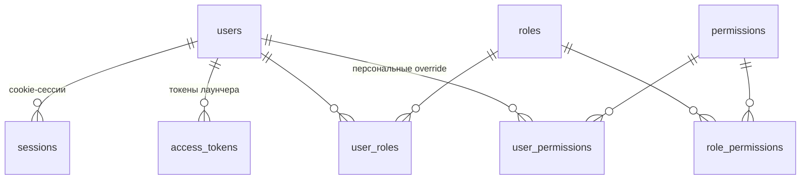
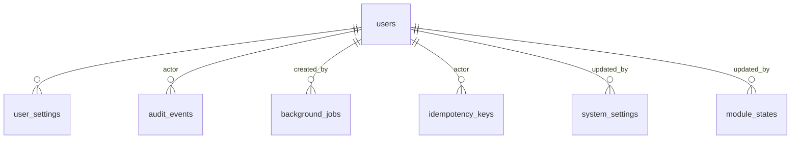
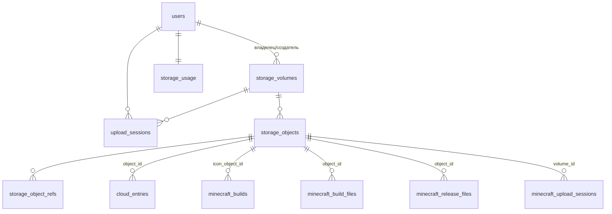
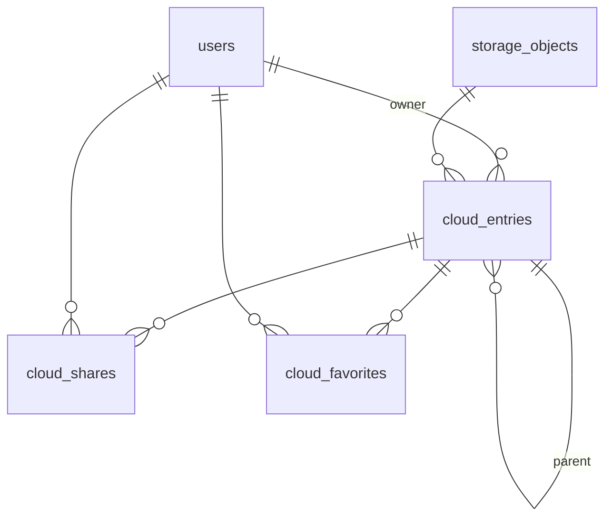
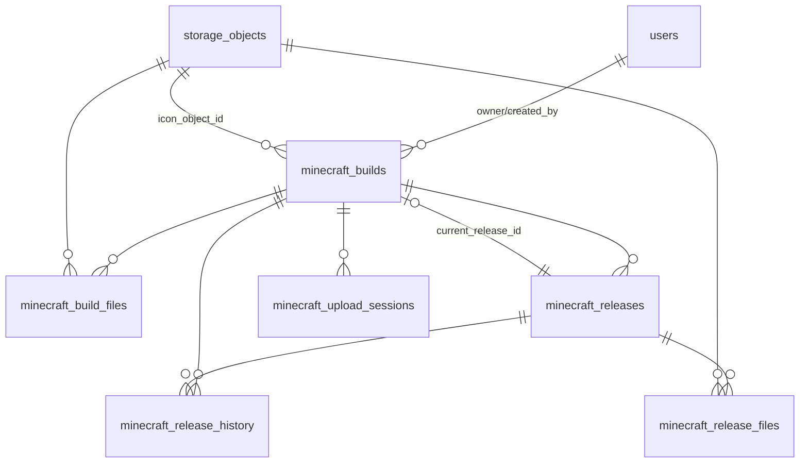
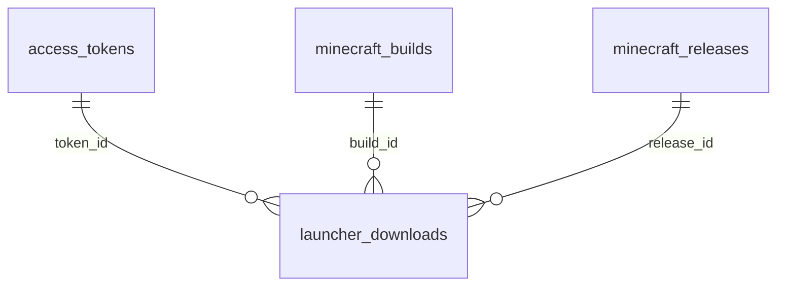

# NEXUS WORKSPACE — база данных

Документ описывает схему PostgreSQL: таблицы, связи, ключи, индексы,
каскады и политику миграций. Источник истины — файлы
[`backend/migrations`](../backend/migrations); при расхождении документа и
миграции приоритет у миграции.

* СУБД: PostgreSQL 14+.
* Расширение: `pgcrypto` (для `gen_random_uuid()`).
* Идентификаторы: `uuid`, кроме `system_metrics` (`bigserial`).
* Время: `timestamptz`.
* Миграции применяет `sqlx::migrate!` при старте backend или `nexus migrate`.

---

## 1. Группы таблиц

| Группа | Таблицы |
|---|---|
| Доступ | `users`, `roles`, `permissions`, `role_permissions`, `user_roles`, `user_permissions`, `sessions`, `access_tokens` |
| Система | `system_settings`, `user_settings`, `audit_events`, `background_jobs`, `system_metrics`, `module_states`, `idempotency_keys`, `quota_defaults` |
| Хранение | `storage_volumes`, `storage_objects`, `storage_object_refs`, `upload_sessions`, `storage_usage` |
| Cloud | `cloud_entries`, `cloud_shares`, `cloud_favorites`, `cloud_trash` (view) |
| Minecraft | `minecraft_builds`, `minecraft_build_files`, `minecraft_releases`, `minecraft_release_files`, `minecraft_loader_versions`, `minecraft_release_history`, `minecraft_upload_sessions` |
| Launcher | `launcher_downloads` |

Всего 32 таблицы и одно представление.

---

## 2. ER-диаграммы

### 2.1. Доступ



* `user_roles` — роль выдаётся пользователю; каскад при удалении любой стороны.
* `role_permissions` — право входит в роль; каскад.
* `user_permissions` — персональное включение/выключение права (`granted`).
* `sessions` — хранится только SHA-256 токена cookie, не сам токен.
* `access_tokens` — токены лаунчера `nxl_…`; хранится SHA-256, scopes в `text[]`.

### 2.2. Система



* `system_settings` — глобальные настройки, значение в `jsonb`.
* `user_settings` — персональные настройки, PK `(user_id, key)`.
* `audit_events` — неизменяемый журнал; `actor_id` при удалении пользователя
  становится `null`, `actor_username` сохраняется как историческое значение.
* `background_jobs` — очередь/история фоновых задач; статусы
  `pending/running/paused/completed/failed/cancelled`.
* `system_metrics` — временные ряды (`captured_at`, `metric`, `value`,
  `labels`, `extra`).
* `module_states` — включение модулей `minecraft` и `cloud`.
* `idempotency_keys` — PK `(actor_id, scope, key)`, хранит хеш запроса и
  сохранённый ответ; каскад при удалении пользователя.
* `quota_defaults` — квоты по областям `cloud` и `minecraft`.

### 2.3. Хранение



Ключевые правила:

* `storage_volumes.root_path` уникален; проверка дублей дополнительно
  выполняется по нормализованному ключу (Windows: регистр не важен,
  завершающий слэш отбрасывается).
* `storage_volumes.scope` — `system`, `cloud` или `minecraft`; `system`
  доступен обоим модулям (K1).
* `storage_volumes.owner_user_id` — персональный владелец; `null` — общий том.
* `storage_objects` уникален по `(volume_id, object_key)`; `sha256`
  проверяется регулярным выражением на 64 hex-символа.
* `storage_object_refs` — PK-ссылка на объект и уникальная пара
  `(owner_module, owner_id)`; `owner_module` ∈ `cloud/minecraft/system`.
* `upload_sessions` — возобновляемые загрузки Cloud; `volume_id` с каскадом,
  `expires_at` для TTL.
* `storage_usage` — агрегат использованной квоты пользователя.

### 2.4. Cloud



* `cloud_entries` — дерево файлов и папок; `parent_id` с `on delete cascade`.
* Уникальность имени в папке — частичный индекс
  `(owner_id, coalesce(parent_id, nil-uuid), lower(name)) where trashed_at is null`.
* `cloud_shares` — публичные ссылки; `token_hash` уникален; `auth_only`
  запрещает анонимный доступ; `password_hash`, `expires_at`,
  `max_downloads`, `download_count`, `revoked_at`.
* `cloud_favorites` — избранное, PK `entry_id`, каскад с записью.

### 2.5. Minecraft



* `minecraft_builds.owner_id` — текущий владелец (K1 предыдущей фазы);
  `created_by` — исторический автор.
* `minecraft_build_files` — уникальность `(build_id, lower(path))`;
  `kind` ∈ `file/dir`, `category`, `side`, `required`.
* `minecraft_releases` — уникальность `(build_id, version)`; опубликованный
  релиз неизменяем, снимок файлов лежит в `minecraft_release_files`.
* `minecraft_loader_versions` — кеш версий загрузчиков.
* `minecraft_release_history` — история действий по сборке/релизу.
* `minecraft_upload_sessions` — загрузки артефактов; `volume_id` каскадом.
  `replace_existing` фиксирует режим атомарной замены на время сессии
  (миграция `0016`), поэтому пауза и продолжение не создают дубль.

### 2.6. Launcher



* `launcher_downloads` — журнал скачиваний: байты, Range, статус, IP,
  User-Agent. `artifact_id` не имеет FK: объект может быть удалён, история
  скачивания остаётся.

---

## 3. Жизненный цикл объекта хранения

```text
загрузка → staging-файл → проверка SHA-256 → перенос в .nexus/objects
         → storage_objects.state = 'committed'
         → ссылка из модуля (storage_object_refs / *_files / cloud_entries)
```

Состояния `storage_objects.state`:

| Состояние | Значение |
|---|---|
| `staging` | объект ещё не зафиксирован (в текущем коде фиксация выполняется сразу после записи) |
| `committed` | файл записан, SHA-256 и размер известны, объект доступен |
| `missing` | файл не найден или размер не совпал при проверке |
| `quarantined` | файл перемещён в `.nexus/quarantine` из-за сбоя фиксации |

Правило удаления:

1. Пользователь удаляет запись Cloud или файл сборки — уменьшается ссылка.
2. Физический объект удаляется только при `ref_count = 0` и отсутствии
   ссылок в `storage_object_refs`, `cloud_entries`, `minecraft_*_files`.
3. Опубликованный релиз удерживает объект: удаление сборки не уничтожает
   файлы, на которые ссылается опубликованный релиз.
4. Том нельзя удалить, пока в нём есть объекты (`VOLUME_NOT_EMPTY`).

`storage_objects.ref_count` — денормализованный счётчик для быстрых
проверок; источник истины — набор ссылок в таблицах модулей.

---

## 4. Ключи, индексы и каскады

### 4.1. Доступ

| Таблица | PK / уникальность | Каскады |
|---|---|---|
| `users` | `id`; `lower(username)` уникален | — |
| `roles` | `id`; `key` уникален | — |
| `permissions` | `key` | — |
| `role_permissions` | `(role_id, permission_key)` | обе стороны `cascade` |
| `user_roles` | `(user_id, role_id)` | обе стороны `cascade` |
| `user_permissions` | `(user_id, permission_key)` | обе стороны `cascade` |
| `sessions` | `id`; `token_hash` уникален | `user_id → users` cascade |
| `access_tokens` | `id`; `token_hash` уникален | `user_id → users` cascade |

### 4.2. Система

| Таблица | PK / уникальность | Каскады |
|---|---|---|
| `system_settings` | `key` | `updated_by → users` set null |
| `user_settings` | `(user_id, key)` | `user_id → users` cascade |
| `audit_events` | `id` | `actor_id → users` set null |
| `background_jobs` | `id` | `created_by → users` set null |
| `system_metrics` | `id` (bigserial) | — |
| `module_states` | `key` | `updated_by → users` set null |
| `idempotency_keys` | `(actor_id, scope, key)` | `actor_id → users` cascade |
| `quota_defaults` | `scope` | — |

### 4.3. Хранение

| Таблица | PK / уникальность | Каскады |
|---|---|---|
| `storage_volumes` | `id`; `root_path` уникален | `owner_user_id/created_by → users` set null |
| `storage_objects` | `id`; `(volume_id, object_key)` уникален | `volume_id → storage_volumes` restrict |
| `storage_object_refs` | `id`; `(owner_module, owner_id)` уникален | `object_id → storage_objects` cascade |
| `upload_sessions` | `id` | `user_id → users` cascade; `volume_id → storage_volumes` cascade |
| `storage_usage` | `user_id` | `user_id → users` cascade |

Индексы:

* `storage_volumes_enabled_idx (enabled, state)`;
* `storage_volumes_disk_idx (disk_mount)`;
* `storage_volumes_scope_idx (scope, owner_user_id)` — K1;
* `storage_objects_sha_idx`, `_volume_idx`, `_state_idx`;
* `upload_sessions_user_idx`, `_expires_idx`;
* `minecraft_upload_sessions_user_idx`, `_expires_idx`.

### 4.4. Cloud

| Таблица | PK / уникальность | Каскады |
|---|---|---|
| `cloud_entries` | `id`; частичный уникальный индекс имени | `owner_id → users` cascade; `parent_id → cloud_entries` cascade; `object_id → storage_objects` set null |
| `cloud_shares` | `id`; `token_hash` уникален | `entry_id → cloud_entries` cascade; `owner_id → users` cascade |
| `cloud_favorites` | `entry_id` | `entry_id → cloud_entries` cascade; `user_id → users` cascade |

### 4.5. Minecraft

| Таблица | PK / уникальность | Каскады |
|---|---|---|
| `minecraft_builds` | `id`; `slug` уникален | `owner_id/created_by → users` set null; `current_release_id → minecraft_releases` set null; `icon_object_id → storage_objects` set null |
| `minecraft_build_files` | `id`; `(build_id, lower(path))` уникален | `build_id → minecraft_builds` cascade; `object_id → storage_objects` set null |
| `minecraft_releases` | `id`; `(build_id, version)` уникален | `build_id → minecraft_builds` cascade |
| `minecraft_release_files` | `id` | `release_id → minecraft_releases` cascade; `object_id → storage_objects` set null |
| `minecraft_loader_versions` | `id`; `(loader_type, loader_version, minecraft_version)` уникален | — |
| `minecraft_release_history` | `id` | `build_id → minecraft_builds` cascade; `release_id/actor_id → ...` set null |
| `minecraft_upload_sessions` | `id` | `build_id → minecraft_builds` cascade; `user_id → users` cascade; `volume_id → storage_volumes` cascade |

### 4.6. Launcher

| Таблица | PK / уникальность | Каскады |
|---|---|---|
| `launcher_downloads` | `id` | `token_id → access_tokens` set null; `build_id → minecraft_builds` set null; `release_id → minecraft_releases` set null |

---

## 5. Представление `cloud_trash`

`cloud_trash` — **view**, а не таблица. Корзина хранится полем
`cloud_entries.trashed_at`; view даёт совместимый взгляд «как таблица» и не
создаёт второго источника истины. Это исключает рассинхронизацию при
восстановлении и очистке.

```sql
create or replace view cloud_trash as
select id, owner_id, parent_id, name, entry_type, object_id,
       size_bytes, content_type, trashed_at
from cloud_entries
where trashed_at is not null;
```

---

## 6. Политика миграций

1. Файлы лежат в `backend/migrations`, имя — `NNNN_описание.sql`.
2. Номер монотонно растёт; **дубликаты номеров запрещены** — `sqlx` хранит
   версию и контрольную сумму применённой миграции.
3. Изменение уже применённой миграции запрещено: исправление оформляется
   новой миграцией.
4. Миграции должны быть идемпотентны там, где это возможно
   (`if not exists`, `on conflict do nothing`), и не удалять данные без
   явного решения.
5. Каждая миграция проверяется тестом `TestEnv::new()`: чистая схема
   `public` + все миграции + синхронизация каталога прав.
6. Обратимость: down-миграции не поддерживаются; откат — восстановление
   резервной копии БД (см. `ADMIN_GUIDE.md`).

### 6.1. Таблица «файл миграции → таблицы»

| Миграция | Что создаёт/меняет |
|---|---|
| `0001_init.sql` | `users`, `roles`, `permissions`, `role_permissions`, `user_roles`, `user_permissions`, `sessions`, `access_tokens`, `system_settings`, `user_settings`, `audit_events`, `background_jobs`, `system_metrics`, `module_states` |
| `0002_storage.sql` | `storage_volumes`, `storage_objects`, `storage_object_refs`, `upload_sessions`, `storage_usage` |
| `0003_cloud.sql` | `cloud_entries`, `cloud_shares`, `cloud_favorites`; `upload_sessions.parent_id` |
| `0004_minecraft.sql` | `minecraft_builds`, `minecraft_build_files`, `minecraft_releases`, `minecraft_release_files`, `minecraft_loader_versions`, `minecraft_release_history`, `minecraft_upload_sessions` |
| `0005_launcher.sql` | `launcher_downloads`, право `launcher.manage` |
| `0006_system.sql` | поля `background_jobs` (`cancellable`, `cancel_requested`, `updated_at`), индексы метрик и аудита |
| `0007_idempotency.sql` | `idempotency_keys` |
| `0008_quotas.sql` | `users.quota_bytes`, `quota_defaults` |
| `0009_metrics_extra.sql` | `system_metrics.extra` |
| `0010_cloud_trash_view.sql` | view `cloud_trash` |
| `0011_background_jobs_pause.sql` | `background_jobs.pause_requested`, `paused_at`, индекс очереди |
| `0012_cloud_shares_auth_only.sql` | `cloud_shares.auth_only`, индекс корзины |
| `0013_minecraft_builds_owner.sql` | `minecraft_builds.owner_id`, индекс владельца |
| `0014_storage_volume_scope.sql` | `storage_volumes.scope`, `owner_user_id`, индекс `(scope, owner_user_id)` — K1 |
| `0015_launcher_repository.sql` | `minecraft_releases.channel`, `launcher_manifest`, `launcher_manifest_hash/schema/at`, индексы канала |
| `0016_minecraft_upload_replace.sql` | `minecraft_upload_sessions.replace_existing` — режим замены переживает паузу/resume |
| `0017_minecraft_release_unpublished.sql` | статус релиза `unpublished` для снятия сборки с публикации |
| `0018_minecraft_build_publication_sync.sql` | выравнивание статуса сборки и текущего релиза: публикация, активация, архивирование |

> Номер `0013` занят миграцией владельца сборки, поэтому привязка томов K1
> оформлена как `0014`, чтобы не дублировать версию `sqlx`.

`minecraft_releases.channel` — `stable|beta`, по умолчанию `stable` для всех
существующих строк. `launcher_manifest` — неизменяемый JSON-снимок формата
MyLauncher (`manifestVersion: 1`), `launcher_manifest_hash` — SHA-256
канонического JSON, `launcher_manifest_schema` — версия схемы снимка.
Внутренний `manifest` (`schema_version: "1.0"`) хранится отдельно и не меняет
свой контракт.

---

## 7. Что изменилось в K1

* `storage_volumes.scope` — `system` (по умолчанию), `cloud`, `minecraft`.
* `storage_volumes.owner_user_id` — `null` (общий) или пользователь.
* Индекс `storage_volumes_scope_idx (scope, owner_user_id)`.
* Существующие тома после миграции: `scope='system'`, `owner_user_id=null`,
  то есть доступны обоим модулям как раньше.
* `pick_volume` учитывает область и владельца:
  `scope IN ('system', <модуль>)` и
  `owner_user_id IS NULL OR owner_user_id = <пользователь>`.
* Персональный том другого пользователя не выбирается и не раскрывается:
  явный запрос возвращает `404 NOT_FOUND`.

---

## 8. Принятые отклонения на уровне данных (K5)

| Тема | Решение | Следствие для схемы |
|---|---|---|
| `cloud_trash` | **view**, не таблица (§5) | нет отдельной таблицы, нет триггеров синхронизации; корзина = `cloud_entries.trashed_at is not null` |
| Шаринг между пользователями | вне §8: только публичные и auth-only ссылки | нет таблиц ACL/«доступ пользователю»; `cloud_shares` принадлежит владельцу записи |
| Delta-обновления | задел, в 1.0 не реализованы | нет колонок/таблиц `delta`; манифест и `docs/schemas/manifest-1.0.json` поле не допускают |
| Активные соединения | in-flight HTTP + WebSocket в памяти процесса | в БД не сохраняются, переносимого счётчика TCP нет |
| Скорость дисков | IO процесса NEXUS через `sysinfo` | `system_metrics` хранит агрегаты процесса, не per-disk значения |

### 8.1. Регистрация имён и длина путей

Правила применяются одновременно в приложении и в уникальном индексе БД,
поэтому обойти их прямым `INSERT` нельзя:

* имя нормализуется в Unicode **NFC**;
* в одной папке имена сравниваются **без учёта регистра** (индекс по
  `lower(name)` и `parent_id`); коллизия возвращает `409 FILE_NAME_CONFLICT`;
* виртуальный путь ограничен **240 UTF-16** единицами, одно имя — **128**;
  превышение возвращает `422 PATH_TOO_LONG`/`VALIDATION_ERROR` без обрезания;
* запрещены зарезервированные имена Windows (`CON`, `NUL`, `COM1`…),
  альтернативные потоки данных (`:`), `..`, абсолютные и UNC-пути,
  завершающие точка/пробел;
* физические объекты лежат по коротким сгенерированным ключам, поэтому
  лимит виртуального пути не переносится на длину пути в хранилище.

Путь к объекту в БД (`storage_objects.object_key`) не содержит пользовательских
имён — это делает backup/restore независимым от длины исходного пути.

### 8.2. Проверка миграций на пустой базе

`backend/tests/migrations_tests.rs` (K3) создаёт одноразовую базу, применяет
**все** файлы миграций, сверяет `_sqlx_migrations` с каталогом `migrations/`
(номера, количество, `success`) и проверяет ключевые объекты, включая
`cloud_trash` как view. Тест запускается отдельной командой `cargo test --test migrations_tests`.

---

## NEXUS AI Workspace (миграция `0019_ai.sql`)

Основные таблицы: `ai_provider_configs`, `ai_runtime_nodes`,
`ai_runtime_enrollment_codes`, `ai_runtime_commands`, `ai_runtime_events`,
`ai_workspaces`, `ai_user_quotas`, `ai_conversations`, `ai_messages`,
`ai_attachments`, `ai_tasks`, `ai_task_events`, `ai_tool_executions`,
`ai_tool_approvals`, `ai_skills`, `ai_skill_files`, `ai_skill_versions`,
`ai_skill_assignments`, `ai_tool_policies`, `ai_programs`.

Ключевые инварианты:

* `ai_messages (conversation_id, sequence)` — уникальная последовательность;
* `ai_tool_executions (task_id, tool_call_id)` — идемпотентность tool call;
* `ai_tool_approvals (execution_id)` — один approval на execution, TTL,
  `args_hash`, `consumed_at`;
* `ai_tasks (owner_id, idempotency_key)` — идемпотентное создание задач;
* `ai_runtime_nodes.token_hash` — только SHA-256 device token;
* `ai_provider_configs.api_key_cipher` — AES-256-GCM ciphertext;
* `ai_workspaces.root_path` — не возвращается пользователю без `ai.admin.manage`.

Источник истины — PostgreSQL; Runtime/WebSocket не хранят историю и статусы как
единственную копию.
